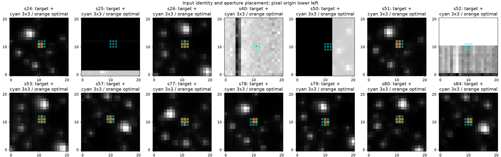
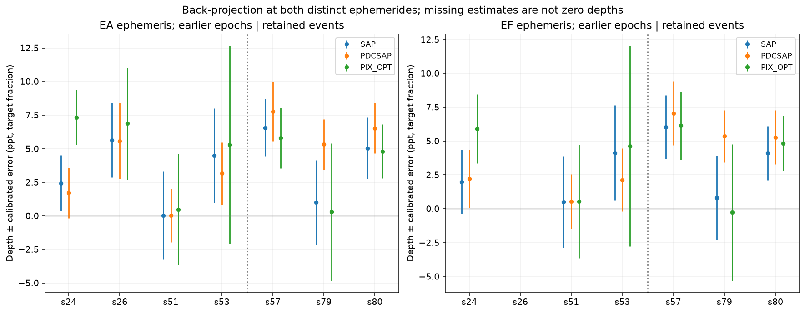
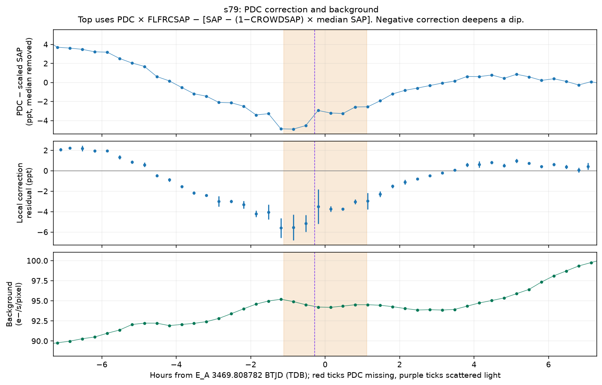
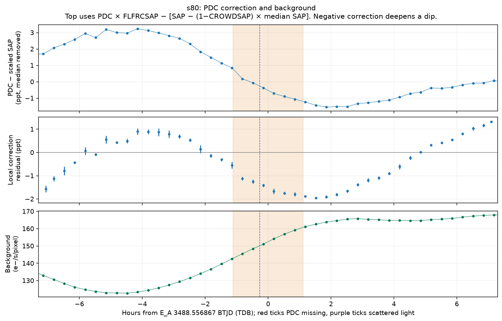
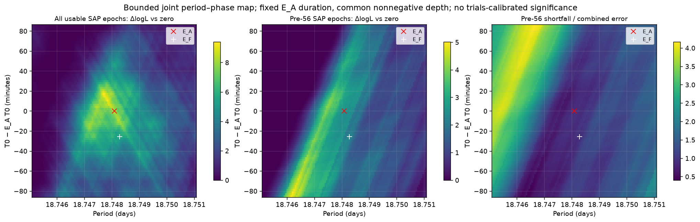
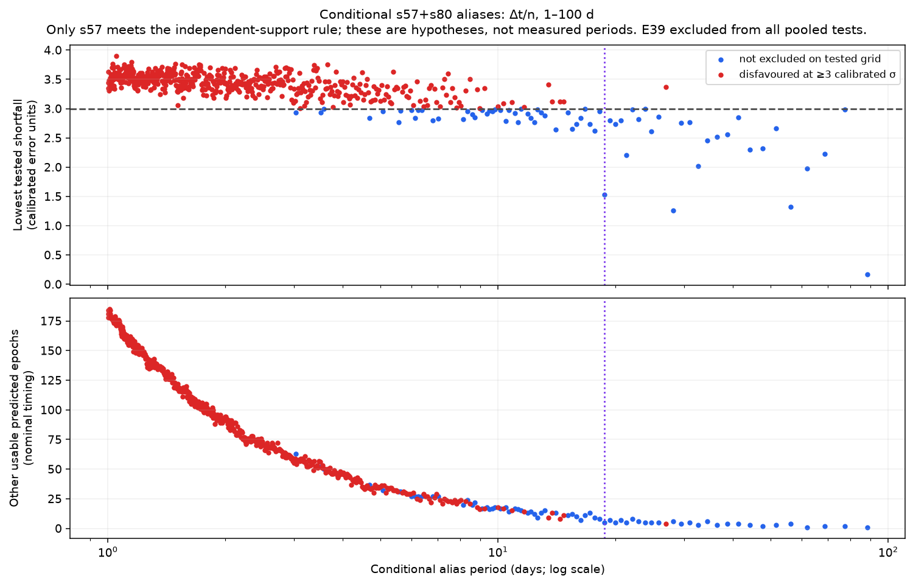
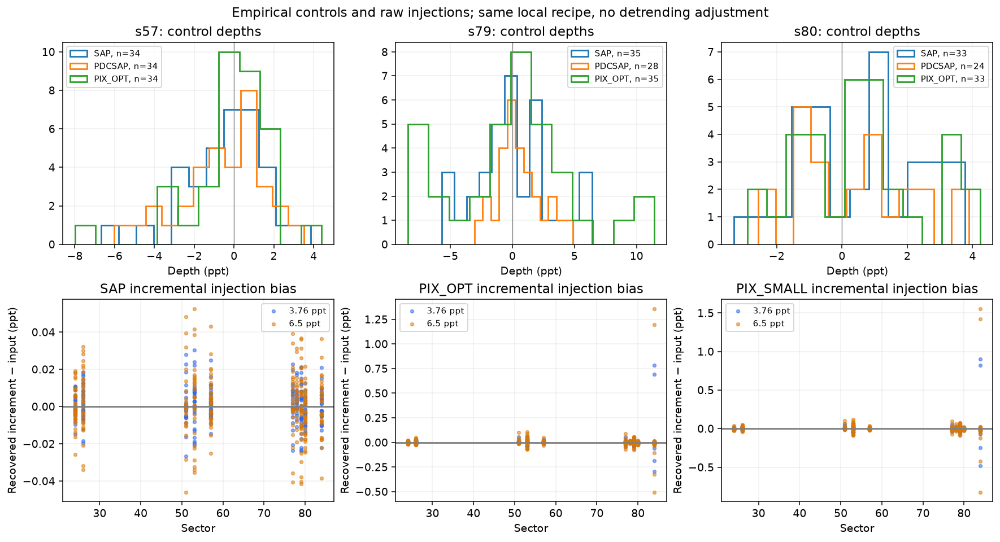

# TIC 332366289: candidate-only light-curve follow-up v1

## Result: `PERIOD_AMBIGUOUS`

Executed 2026-10-01. This is a separate post-P12 follow-up, not a search rerun, a revision of a P12 verdict/tier, or a planet validation. P12 and localisation_v1 were read-only inputs.

**Is the dip real in raw data?** There is modest pooled evidence for dimming: at the predeclared E_A windows, retained-event SAP is **4.88 ± 1.41 ppt (S/N 3.47)** and background-subtracted optimal-aperture TESScut is **4.85 ± 1.43 ppt (3.38)** after the approximate crowding conversion. These share photons and must not be combined as independent detections. The evidence does not establish three repeated raw events or an astrophysical/planetary cause.

**How many events independently support it?** **One: E00, sector 57**, under the fixed exploratory rule (SAP S/N ≥2.5, optimal-pixel S/N ≥2, compatible positive depths). E33/s80 is suggestive (SAP 2.20, pixels 2.40), but falls below the SAP requirement. E32/s79 is unconfirmed (SAP 0.31, pixels 0.05). None of the earlier usable events meets both requirements. Dropping s57 lowers the retained SAP joint S/N to **1.97**. Even the one qualifying event is moderate evidence, not a ≥3σ detection independently in both products.

**Is PDCSAP inflating it?** The measured local PDC correction deepens s80 by **1.49 ± 0.31 ppt** beyond the crowding-scaled SAP depth. In s79, the larger **4.32 ± 2.56 ppt** enhancement is only 1.68 calibrated error units. Its PDCSAP dip is 2.84 error units, below the predeclared ≥3 rule. Thus the strict `PDC_DEPENDENT` status does not fire, although s79’s event support plainly weakens in raw data. The correction is broad and curved around both events; s80 also lies on a strong background ramp. These observations identify the numerical contribution of PDC, not the physical cause of the original variability or which internal PDC component produced it.

**Is 18.748 d the period?** It is **neither uniquely supported nor refuted**. Earlier usable SAP epochs give **3.10 ± 1.36 ppt at E_A**, only 0.91 combined error units below the retained-event depth. The E_F sensitivity gives **2.11 ± 1.69 ppt**, also consistent (0.92). With only one qualifying retained raw event there is no data-supported two-event cycle count. A separately labelled, conditional s57+s80 exercise leaves **69 of 612** integer aliases between 1 and 100 d unexcluded on the tested timing grid, including 18.748 d. This count does not mean that 69 periods have been detected.

**A material correction to the inherited inventory:** TESScut returned files for all eight earlier listed sectors, but **s25, s40, s50 and s52 put the target outside the active imaging array**. Their existence is not stellar coverage. Only s24, s26, s51 and s53 provide earlier usable target photometry. No off-detector “nondetection” was used against the candidate.

Secondary flags: `PDC_DEEPENING_S80`, `S79_RAW_EVENT_UNCONFIRMED`, `S80_SUGGESTIVE_BELOW_INDEPENDENT_RULE`, `FOUR_INVENTORY_SECTORS_OFF_SCIENCE_ARRAY`, `CONDITIONAL_ALIASES_ONLY`, `EMPIRICAL_TAILS_UNRESOLVED`, `E39_DIAGNOSTIC_ONLY`.

## Inputs and identity

The single MAST observation search and one aggregate product-list request returned six earlier LC products: TESS-SPOC s24/s26/s51/s53 plus QLP s51/s53. Downloaded those and eight 21×21 earlier TESScut cubes. Cached later products were only read. QLP s80 remained excluded; it was not downloaded or analysed. No other star was acquired or searched.

All stellar LC headers identify TIC 332366289; `TIME` is BTJD, `BJDREFI=2457000`, `TIMESYS=TDB`, `TIMEREF=SOLARSYSTEM`. The native integration spans are 1800 s (s24/26), 600 s (s51/53), and 200 s (later sectors). Header `TIMEDEL`, `INT_TIME`, `NUM_FRM`, `DEADC`, processing version and data release are recorded in `inputs/product_inventory.json` and `inputs/ccd_geometry.json`. `EXPOSURE` in an LC header is the summed product exposure, not a single cadence. The box is averaged over each native cadence span; uniform temporal integration within that span is assumed. It does not model the detailed two-second cosmic-ray-rejection pattern.

Each usable TESScut frame was matched one-to-one by nearest TIME within half a native cadence, then assigned the matched TESS-SPOC target-barycentric time. Earlier offsets range from −48.55 to +10.37 s; later offsets from −45.53 to +51.86 s. Apertures were mapped by physical CCD row/column coordinates, with exact equality between the SPOC optimal-aperture pixel count and the count in the cutout. Original times and offsets remain in the new arrays. QLP times were separately matched by time; the earlier QLP schema is `KSPSAP_FLUX`, the later schema `DET_FLUX`. All-NaN QLP error columns are unused. Product versions, hashes and origins are in the inventories.

The target CCD positions below explain the four misleading inventory entries. Official TESS science coordinates span columns 45–2092 and rows 1–2048; all four off-array findings survive a one-pixel convention change. The images show collateral/blank regions at the predicted target position, not a stellar point source. This was verified from downloaded FITS geometry and the [official tess-point coordinate description](https://github.com/tessgi/tess-point); the broken installed tess_stars2px module was not run.

| Sector | Cadence (s) | BTJD span | CCD target col, row | Active target? | E_A cycles in product span |
| --- | --- | --- | --- | --- | --- |
| 24 | 1800 | 1955.804–1982.262 | 1038.64, 1939.80 | yes | 1 |
| 25 | 1798 | 1983.659–2009.284 | 1963.98, 2057.85 | **no** | 2 |
| 26 | 1800 | 2010.283–2035.116 | 1407.94, 1804.98 | yes | 1 |
| 40 | 600 | 2390.658–2418.852 | 2120.94, 1310.28 | **no** | 1 |
| 50 | 600 | 2665.276–2691.505 | 42.94, 161.36 | **no** | 1 |
| 51 | 600 | 2692.949–2717.533 | 1288.54, 844.91 | yes | 1 |
| 52 | 600 | 2718.638–2743.075 | 1747.28, 2078.08 | **no** | 2 |
| 53 | 600 | 2743.998–2768.977 | 1577.98, 1710.96 | yes | 1 |
| 57 | 200 | 2853.350–2882.111 | 1840.07, 36.75 | yes | 1 |
| 77 | 200 | 3395.483–3423.550 | 90.88, 1140.31 | yes | 1 |
| 78 | 200 | 3434.267–3449.617 | 1380.42, 1803.49 | yes | 0 |
| 79 | 200 | 3452.536–3479.675 | 568.21, 1836.19 | yes | 1 |
| 80 | 200 | 3479.885–3506.336 | 1688.77, 589.88 | yes | 1 |
| 84 | 200 | 3584.584–3610.338 | 1859.45, 53.40 | yes | 1 |


`events.csv` has all 15 E_A and 15 E_F epoch/sector intersections, including gaps and off-array rows, with coverage, quality, scattered-light fractions, edge/gap/dump distances and per-epoch availability. `results/all_cycle_sector_coverage.csv` maps every cycle across the full data baseline against every listed sector. Sector 77’s predicted E29 has no in-event samples; sector 78 contains no predicted E_A/E_F centre. Both are used when other alias predictions fall in their actual data.



## Fixed method, calibration and changes

`PLAN.md` and `config.json` were sealed before any new depth measurement. The premeasurement missing-product addendum is separately timestamped and sealed. These are adopted follow-up choices, not P12 rules.

Each product and sector receives the same linear OLS baseline, using a five-hour reference interval on each side after a one-hour guard beyond half-duration. No flux clipping or baseline selection on the event was done. A signed exposure-integrated box is fitted in the event window. Positive tabulated depth means negative plotted flux residual. Require ≥75% in-event exposure coverage, ≥60% of each reference side and at least two in-event / three per-side points. Reject local windows crossing a gap larger than 2.5 cadences or a momentum dump. The allowance can span an isolated missing cadence; it does not bridge longer gaps. Masks are derived from each product’s matched times, never transferred by array index. Pixel quality must be zero; matched SPOC quality rejects bits 191. Scattered-light flags are recorded. QLP ignores only the documented low-precision bit (2^12 before s56, 2^30 later) and otherwise requires good quality.

Pixel flux is aperture sum minus aperture size × the per-frame median background. The background uses a fixed set of the faintest 20% of median-image pixels, outside four pixels from the target and outside the optimal aperture. The input FLUX_BKG arrays are zero: no prior background was subtracted twice. The small aperture is 3×3. A median background is a deliberately simple choice; it does not model row/column stripes or spatial gradients, which can remain as correlated noise.

PDCSAP already carries crowding/flux-fraction corrections; SAP does not. Native depths are tabulated below. For cross-sector raw pooling, divide SAP and optimal-pixel fractional depth by CROWDSAP (an approximate target-fraction correction); FLFRCSAP cancels from fractional depths. The pixel sky estimate may differ from the pipeline sky estimate, so these are not guaranteed to have identical zero points. Small-aperture and QLP crowding/throughput are not inferred, and neither is pooled with SAP. See the [TESS crowding documentation](https://heasarc.gsfc.nasa.gov/docs/tess/UnderstandingCrowdingv2.html).

Control centres lie on a deterministic 0.65-d grid. Their local windows do not overlap each other and avoid both known ephemerides by a full-window margin. The depth error is the maximum of local white error, control SD, robust MAD and control RMS about zero, with a count correction for sparse events. Control means are reported; they are not subtracted from the measured events. Common-time paired PDC/SAP controls preserve their covariance; their difference error also has a local residual-difference white floor. Nonoverlapping controls can still share longer-timescale systematics. Ratios labelled S/N or σ are calibrated error units, not demonstrated Gaussian tail probabilities.

Two inherited amplitudes, 3.76 and 6.50 ppt, were injected into each raw SAP/optimal-pixel/small-pixel control light curve with the native exposure-integrated box. Recovery is reported both absolutely and incrementally relative to that same unmodified control. These injections test the local estimator on the extracted curves; they do not rerun SPOC/PDC or measure PDC’s transfer function. The deterministic procedure has a recorded seed, but uses no random draws.

Implementation corrections are disclosed in `inputs/implementation_corrections.json`: mapping the early QLP column name; avoiding rejection of a finite aperture because an unrelated cutout pixel is NaN; and rejecting the four off-imaging-array inputs after the aperture/geometry check. Initial diagnostic residuals from those nonstellar cutouts are not retained as science measurements. No detrending window, error rule, significance threshold, ephemeris or alias bound was adjusted to change the outcome.

## Per-event depths

Native fractional depths ± empirically calibrated errors, in ppt. A dash means unavailable or rejected by the fixed recipe, not zero. `OPT` and `3×3` are background-subtracted TESScut. The CSV/JSON include per-product reasons, counts, white errors, empirical null ranks and crowding-converted depths. E39 is diagnostic only in every table and pooled calculation.

### EA

| Sector / cycle | Centre BTJD | PDCSAP | SAP | OPT | 3×3 | QLP |
| --- | --- | --- | --- | --- | --- | --- |
| s24 / -48 | 1969.961992 | 1.70 ± 1.87 | 2.36 ± 2.01 | 7.12 ± 1.99 | 9.86 ± 3.02 | — |
| s25 / -47 | 1988.710077 | — | — | — | — | — |
| s25 / -46 | 2007.458162 | — | — | — | — | — |
| s26 / -45 | 2026.206247 | 5.57 ± 2.83 | 5.41 ± 2.67 | 6.60 ± 4.00 | 5.84 ± 4.01 | — |
| s40 / -25 | 2401.167945 | — | — | — | — | — |
| s50 / -10 | 2682.389218 | — | — | — | — | — |
| s51 / -9 | 2701.137302 | 0.02 ± 2.00 | 0.03 ± 3.17 | 0.46 ± 4.00 | 0.57 ± 4.43 | — |
| s52 / -8 | 2719.885387 | — | — | — | — | — |
| s52 / -7 | 2738.633472 | — | — | — | — | — |
| s53 / -6 | 2757.381557 | 3.15 ± 2.31 | 4.29 ± 3.35 | 5.06 ± 7.04 | 6.34 ± 8.44 | 3.95 ± 7.90 |
| s57 / 0 | 2869.870066 | 7.77 ± 2.20 | 6.28 ± 2.06 | 5.54 ± 2.15 | 5.25 ± 1.87 | 1.11 ± 2.31 |
| s77 / 29 | 3413.564528 | — | — | — | — | — |
| s79 / 32 | 3469.808782 | 5.31 ± 1.87 | 0.97 ± 3.09 | 0.27 ± 5.00 | 1.42 ± 6.26 | -1.06 ± 6.02 |
| s80 / 33 | 3488.556867 | 6.53 ± 1.87 | 4.86 ± 2.21 | 4.62 ± 1.93 | 5.74 ± 1.82 | — |
| s84 / 39 | 3601.045376 | — | 3.17 ± 2.58 | 4.18 ± 54.70 | 2.51 ± 66.33 | -0.70 ± 23.56 |

### EF

| Sector / cycle | Centre BTJD | PDCSAP | SAP | OPT | 3×3 | QLP |
| --- | --- | --- | --- | --- | --- | --- |
| s24 / -48 | 1969.935388 | 2.21 ± 2.14 | 1.93 ± 2.30 | 5.74 ± 2.48 | 6.44 ± 3.16 | — |
| s25 / -47 | 1988.683661 | — | — | — | — | — |
| s25 / -46 | 2007.431934 | — | — | — | — | — |
| s26 / -45 | 2026.180207 | — | — | — | — | — |
| s40 / -25 | 2401.145668 | — | — | — | — | — |
| s50 / -10 | 2682.369763 | — | — | — | — | — |
| s51 / -9 | 2701.118036 | 0.54 ± 2.02 | 0.47 ± 3.26 | 0.53 ± 4.04 | 0.87 ± 4.50 | — |
| s52 / -8 | 2719.866309 | — | — | — | — | — |
| s52 / -7 | 2738.614582 | — | — | — | — | — |
| s53 / -6 | 2757.362856 | 2.13 ± 2.33 | 3.95 ± 3.34 | 4.42 ± 7.08 | 5.65 ± 8.40 | 1.52 ± 7.24 |
| s57 / 0 | 2869.852494 | 7.04 ± 2.37 | 5.78 ± 2.25 | 5.88 ± 2.40 | 5.85 ± 2.08 | 2.23 ± 2.45 |
| s77 / 29 | 3413.552412 | — | — | — | — | — |
| s79 / 32 | 3469.797231 | 5.36 ± 1.93 | 0.79 ± 3.02 | -0.27 ± 4.93 | -0.42 ± 6.12 | -3.22 ± 6.16 |
| s80 / 33 | 3488.545504 | 5.27 ± 2.00 | 3.96 ± 1.91 | 4.65 ± 1.96 | 5.76 ± 1.88 | — |
| s84 / 39 | 3601.035142 | — | 3.39 ± 2.66 | 4.84 ± 50.03 | 2.79 ± 60.63 | 1.89 ± 23.16 |


E_A: P=18.748084871649127 d, T0=2869.8700663100585 BTJD, duration=2.22796 h. E_F: P=18.748273038412 d, T0=2869.852493755 BTJD, duration=1.93 h. The E_F centre is about 38.3 min earlier in s24 and 16.4 min earlier in s80. These are distinct sensitivity analyses. In s26 the shorter, shifted E_F window has 74.09% good coverage, below the fixed 75% threshold, so its depth is unavailable. This is an actual cadence/quality boundary, not evidence against E_F.

The raw depths of the three retained events are statistically compatible with a constant depth (SAP p=0.35, OPT p=0.61), but large errors make that a weak test. Agreement with a constant is not repeated detection. The seven non-diagnostic E_A SAP epochs pooled together give **3.96 ± 0.98 ppt, S/N 4.05**. This still does not resolve the independent-event or alias problem. The s24 pixels show a larger deficit than SAP; the s26 raw signal is weak, and s51 is near zero. These differences remain visible rather than being tuned away.

QLP gives no compelling independent confirmation: s57 is 1.11 ± 2.31 ppt and s79 −1.06 ± 6.02 ppt. The s51 QLP reference window fails the gap rule and has no valid calibration controls under that rule. No QLP s80 estimate is permitted. The QLP aperture/detrending response is not calibrated by the SAP/pixel injections.



## PDC diagnostics and inherited K9a

| Sector | PDC minus crowding-scaled SAP depth (ppt) | Difference / error | Paired controls | Interpretation |
| --- | --- | --- | --- | --- |
| 57 | 1.22 ± 0.84 | 1.46 | 34 | small enhancement |
| 79 | 4.32 ± 2.56 | 1.68 | 28 | larger correction, weak calibrated evidence |
| 80 | 1.49 ± 0.31 | 4.78 | 24 | measured deepening |
| 84 | unmeasurable | — | 22 | E39 PDC gap; never pooled |


The s80 correction contributes a clear positive depth increment under this local recipe, but the raw dip is not erased. Its background rises from a reference-side median of 125.45 to 165.42 e−/s/pixel. In s79 the reference medians are 92.06 and 95.20; its broad PDC-minus-SAP trough contributes most of the nominal PDCSAP event depth, but the same-sector correction controls are variable enough that its excess is only 1.68 error units. In s57 the background is almost flat (95.20 to 95.35), and the excess depth is 1.22 ± 0.84 ppt. No momentum dump crosses these local windows. Full proximity/quality diagnostics are in `events.csv`.

In s84 half the event is scattered-light flagged and PDC is missing through the first part of the event. The fixed recipe therefore cannot produce a PDCSAP or paired-correction depth. The raw SAP diagnostic is 3.17 ± 2.58 ppt. Pixel control scatter is extreme (OPT 54.7 ppt), so a visually modest local pixel dip is not a calibrated detection. E39 was never put back into any joint result or alias rejection.

The inherited K9a values are verified in `tiers_p12_0.json`: r=0.8834/0.9990/0.9976 for s79/s80/s84. `src/tesshunter/verdict_tiers.py::k9_sector` correlates the **unsubtracted aperture series with sky flux** within three fit durations of event centres; `audit_rules.py` supplies the 0.7 threshold. It does not correlate SAP with PDCSAP, nor does it directly test transit-depth inflation. Both unsubtracted aperture and sky contain the same changing background. The new wider-window raw-aperture/background correlations are 0.984/0.9996/0.9990, while background-subtracted SAP/background correlations are 0.211/0.118/0.004. Different windows and apertures mean these are not numerical reproductions of K9a. They show why a high raw/sky r alone is not proof that PDC created a transit.

The PDC plots show the actual scaled flux correction plus the locally detrended correction residual. Its sign is explicit: a negative correction produces positive extra fitted depth. The exact internal PDC basis vectors/components were not reconstructed, and the data do not identify a unique physical explanation for the correction.




## Period and alias analysis

Back-projection is measured independently for E_A and E_F. E_A retains four earlier SAP epochs; E_F retains three because of s26’s coverage boundary. E77 is a data gap and s78 has no prediction. Earlier depths are compatible with the retained raw amplitude, but none independently meets the joint SAP/pixel support rule. The null s51 epoch alone is too noisy to refute the measured few-ppt signal.

The bounded map covers P=18.74508487–18.75108487 d and T0=E_A T0 ±0.06 d on a 121×81 grid. It uses the E_A duration everywhere, common nonnegative SAP depth, calibrated event errors, and no E39. Seven epochs are usable throughout this map, so its highest score is not obtained by dropping an inconvenient epoch. The best grid location is P=18.74768487 d, T0=2869.88206631 BTJD, depth=4.10 ±0.95 ppt, improvement in log likelihood versus zero depth=9.40. This is a descriptive profile score with 9,801 correlated grid trials, **not** a calibrated discovery significance, an uncertainty interval, or a replacement ephemeris. The E_F marker is shown on this fixed-duration map for timing comparison; the separate E_F table uses its own shorter duration.

The pre-56 shortfall relative to the retained E_A amplitude ranges from 0.40 to 4.17 combined error units across the map. Some timings are disfavoured, but many are not; the entire allowed box does not exclude the reference depth. Therefore the fixed `PERIOD_REFUTED` rule is false.

There is only one qualifying retained raw event, so **no unconditional raw-supported alias set can be enumerated**. The declared conditional s57+s80 exercise takes their 618.68680076-d separation and P=Δt/n for n=7…618. It tests all other covered SAP epochs, including s79, s77/s78 and the earlier stellar data. s84 predictions are retained as diagnostics and never pooled. Off-array sectors are not nondetections. Each alias tests a 5×5 envelope of endpoint timing offsets up to half an E_A duration, stopping early only when one variant survives. An alias is disfavoured only if every tested variant has a joint other-epoch depth at least three combined error units below the anchor depth. The fixed anchor-depth uncertainty is propagated.

Result: **69 conditional aliases survive; 543 are disfavoured on the sampled timing grid.** At 18.74808487 d, the five other usable epochs give 2.77 ±1.25 ppt versus conditional anchor depth 5.84 ±1.57 ppt: shortfall 1.53 error units. Thus that period survives, but it is one of many. The complete CSV includes period, integer n, tested-variant count, best tested timing, joint depth, error, shortfall and s84 diagnostic. The nominal predicted-epoch table is also included.

Surviving nominal periods (days; conditional, six decimal places):

3.032778, 3.515266, 3.576224, 4.687021, 5.071203, 5.573755, 5.624425, 6.006668, 6.125612, 6.249362, 6.378214, 6.798756, 7.030532, 8.140616, 8.360632, 8.592872, 8.713899, 9.098335, 9.374042, 9.518258, 9.666981, 9.820425, 10.142407, 10.486217, 10.667014, 11.047979, 11.248851, 11.457163, 11.897823, 12.131114, 12.373736, 12.626261, 12.889308, 13.163549, 14.061064, 15.089922, 15.467170, 15.863764, 16.281232, 16.721265, 17.185744, 17.676766, 18.196671, 18.748085, 19.333963, 19.957639, 20.622893, 21.334028, 22.095957, 22.914326, 23.795646, 24.747472, 25.778617, 28.122127, 29.461276, 30.934340, 32.562463, 34.371489, 36.393341, 38.667925, 41.245787, 44.191914, 47.591292, 51.557233, 56.244255, 61.868680, 68.742978, 77.335850, 88.383829.


The finite endpoint grid does not prove continuous exclusion between grid samples. This exercise fixes a roughly two-hour duration even for aliases far from 18.748 d and does not fit eccentricity, duration changes, transit timing variations, changing transit depth or long-term within-sector covariance. Short-period rejection can overstate the evidence if separated epochs retain shared noise. It is a bounded hypothesis check, not a blind BLS/TLS search. These limitations weaken any claim of uniqueness further.




## Controls and injection results

Valid E_A control counts per sector and photometry (each product has its own quality/finite mask):

| Sector | SAP | PDCSAP | OPT | 3×3 | QLP |
| --- | --- | --- | --- | --- | --- |
| 24 | 33 | 30 | 33 | 33 | — |
| 26 | 33 | 28 | 33 | 33 | — |
| 51 | 23 | 15 | 21 | 21 | 0 |
| 53 | 31 | 31 | 31 | 31 | 27 |
| 57 | 34 | 34 | 34 | 34 | 34 |
| 77 | 24 | 11 | 20 | 20 | 20 |
| 78 | 20 | 14 | 18 | 18 | 18 |
| 79 | 35 | 28 | 35 | 35 | 35 |
| 80 | 33 | 24 | 33 | 33 | — |
| 84 | 30 | 22 | 30 | 30 | 32 |


There are **1,744 raw injection evaluations**, two amplitudes on the same control windows and three raw photometries, across ten active sectors (including diagnostic s84). These are not 1,744 independent noise realisations: amplitudes and apertures reuse the same cadences. In retained sectors the largest absolute incremental bias over either amplitude and all three raw photometries is **0.083 ppt**. Recovery is essentially linear at the tested amplitudes, while absolute recovered depths retain real control noise and baseline offsets. Extreme s84 control windows produce much larger pixel injection biases, up to about 1.55 ppt; they remain diagnostic. `results/injection_summary.csv` records every sector/product/amplitude count, mean/median incremental bias, scatter, absolute recovery bias and scatter.

The calibration measures the depth estimator’s response after extraction, not whether a source is at TIC 332366289, nor whether instrumental variations can mimic a transit. A few dozen controls per sector cannot establish a Gaussian 3σ or 5σ tail. The SAP/pixel/control series share observations; reporting them separately is essential. The fixed linear model is visibly inadequate in some strongly varying background intervals. The large empirical errors in s79/s84 are retained, not “improved” by switching recipes.



## Inherited facts versus new results

- **Inherited and verified in local records:** Stage A E00/s57, E32/s79 and E33/s80 were kept; E39/s84 was excluded. Survey E_A and packet E_F values match the prompt. Stage A’s kept PDCSAP 6.50 ±0.86 ppt and SAP 3.76 ±0.84 ppt are historical outputs of another detrending/error recipe. Packet fit data include s84 and report four transits. The earlier localisation report is UNRESOLVED and reports target-position PRF deficits of 4.2/2.1/4.6 ppt.
- **New measurements:** all tables and figures in this report, new detector-coverage finding, local SAP/PDCSAP/pixel/QLP depths, controls, injections, PDC differences and conditional period tests.
- **Adopted assumptions:** linear local baseline, exposure-integrated box, fixed timing/alias limits, approximate SAP/OPT CROWDSAP conversion, empirical sector error stationarity and the stated support thresholds.
- **Interpretations:** raw dimming is modest and concentrated in s57/s80; s79 lacks independent raw confirmation; PDC deepens s80 under this recipe; 18.748 d remains an unproven possible period. A failure to reject an amplitude or period is not evidence of a planet.

The localisation-v1 deficits came from a scene/PRF fit with a background regressor, whereas this work sums apertures with per-frame sky subtraction and a linear baseline. They are not the same estimator; no equality was expected or imposed. The new errors include conservative sector control scatter and can be much larger. Nothing here changes the historical localisation status or P12 tier.

## Ground-based follow-up

One careful observing attempt can be useful as an **exploratory test**, especially to obtain a new independent raw event and distinguish a target dip from background/systematic behaviour. The present evidence does not justify treating this as a well-established periodic transit or prioritising expensive validation observations on that premise. An observer would need approximately 1–2 ppt precision in 10–15 minute bins to test a 4–6 ppt, roughly two-hour event, with a small stellar aperture and enough baseline on both sides. This is a signal-to-noise requirement, not a guarantee for any telescope or observing site.

The following windows are conditional on the 18.748-d hypothesis. They include both ephemerides, half the E_A duration, three times the packet’s formal propagated timing error, and one hour of baseline on each side. The formal propagation ignores period–epoch covariance, which is unavailable, and does not cover alternative aliases or timing variations. Times below are approximate UTC calendar renderings of BJD_TDB; an observer must apply the target/site barycentric correction (potentially several minutes), visibility, weather and airmass constraints. These are not local New York observing recommendations.

| Cycle | E_A centre BTJD | Approx UTC centre | Approx UTC window | Formal E_F 1σ (min) |
| --- | --- | --- | --- | --- |
| 78 | 4332.220686 | 2026-10-18 17:16 | 2026-10-18 13:58 to 2026-10-18 20:30 | 22.2 |
| 79 | 4350.968771 | 2026-11-06 11:13 | 2026-11-06 07:55 to 2026-11-06 14:28 | 22.5 |
| 80 | 4369.716856 | 2026-11-25 05:11 | 2026-11-25 01:52 to 2026-11-25 08:26 | 22.7 |
| 81 | 4388.464941 | 2026-12-13 23:08 | 2026-12-13 19:49 to 2026-12-14 02:24 | 23.0 |
| 82 | 4407.213026 | 2027-01-01 17:05 | 2027-01-01 13:45 to 2027-01-01 20:22 | 23.2 |


## Execution, integrity and resource limits

Completed: local environment/job/free-space checks; historical input verification; premeasurement plan/config; one MAST search; bounded earlier-product acquisition; time/aperture/background validation; every listed sector’s coverage; both ephemerides’ per-event measurements; same-recipe controls and raw injections; E39 diagnostics; direct PDC correction inspection; K9 source reading; fixed and joint-map back-projection; conditional aliases; 12 focused passing tests; visual inspection of all 17 scientific figures; machine-readable results; after-run integrity and compact review bundle.

Historical integrity scope: **152 content-read files, 0 changed, 0 missing**, comparing SHA256, size and modification time. This covers the specific packet/v1 inputs, cached LCs/cubes, and every source file scanned for K9. It is not a whole-repository audit. The initial PowerShell fingerprints precede the first report/code reads and are retained. The user-provided instruction file was fingerprinted after its initial read; it is not a historical analysis record. Installed libraries are tracked by package versions rather than historical-file hashes. See `inputs/integrity_before.json`, `integrity_after.json`, `integrity_compare.json` and `initial_integrity.jsonl`.

New science downloads: **191,202,400 bytes (191.2 MB)**, below the 5 GB ceiling. There was one MAST observation search and one aggregated product-list request, then per-product downloads. Network transport retries: 0. Analysis stages use one process and one numerical thread. Brief QA/input commands overlapped the bounded alias process, so peak simultaneous Python processes was two, within the limit. No detached workers were launched. Final wall time and job audit are recorded in `results/resource_usage.json` / `logs/final_jobs.json`; the 3-hour ceiling was not approached. Caches and large arrays are in `D:\tesshunter_followup\tic332366289_lightcurve_v1`; no P12 cache or `data/cache` was written. No git reset/commit/push, automation, external submission, population search, funnel, TRICERATOPS or calibration rerun occurred.

Scientific questions left unresolved: source identity, whether any dip is astrophysical, why the internal PDC correction has its observed form, repeated-event confirmation and a unique period. No pipeline stellar products exist in the returned single-search result for the four off-array sectors; they cannot settle a transit question. QLP s51 and E39 PDC fail the fixed recipe; these are explicit data limitations, not silently imputed values. No result here is a planet probability.

## Reproduction and files

Canonical workspace: `C:\Users\seanj\Downloads\tess-exoplanet-candidate-hunter\tess-exoplanet-candidate-hunter\followup\tic332366289_lightcurve_v1`. Large inputs/arrays: `D:\tesshunter_followup\tic332366289_lightcurve_v1`. The delivered mirror contains the same report, code, tests, compact arrays/results and PNGs. Raw FITS cubes, downloaded ZIPs and caches are excluded from `review_bundle.zip`.

From the canonical `code` directory in PowerShell, with the existing products retained:

```powershell
$env:PYTHONDONTWRITEBYTECODE='1'
$py='C:\Users\seanj\Downloads\tesshunter_venv\Scripts\python.exe'
& $py -B ingest.py lcs
& $py -B ingest.py pixels
& $py -B coverage_geometry.py
& $py -B test_analysis.py
& $py -B analyze.py
& $py -B periods.py map
& $py -B periods.py aliases
& $py -B coverage_complete.py
& $py -B decision.py
& $py -B pixel_check.py
& $py -B figures.py
& $py -B finalize_checks.py
& $py -B report.py
```

For a fresh run, use a fresh isolated workspace, update only the new-workspace paths and wall-clock start in `common.py`, run `inspect_inputs.py`, then predeclare and seal the plan before analysis. Acquisition commands are `fetch.py search`, `fetch.py products`, `ingest.py lcs`, `fetch.py cutouts`. The saved MAST responses are reused on restart; do not issue another search for this completed run. The recorded wall-clock guard deliberately prevents silently continuing this run after its deadline. To reproduce at a later date, explicitly create a new run clock/resource ledger while retaining the scientific config. Do not invoke `predeclare.py` over an existing config; it refuses overwrite.

Key review files: `PLAN.md`, `config.json`, `events.csv`, `results/depths.csv/.json`, `results/pdc_diagnostics.csv/.json`, `results/backprojection.json`, `results/aliases.csv/.json`, `results/alias_nominal_epochs.csv`, `results/joint_period_phase_map.npz`, `results/decision.json`, `results/control_summary.csv`, `results/injection_summary.csv`, `results/conditional_future_windows.csv`, `inputs/` provenance/integrity records, `logs/tests.txt`, `tests/test_analysis.py`, `code/`, `figures/`, and `review_bundle.zip`.
