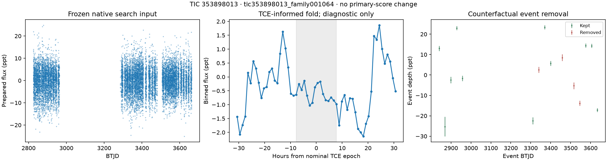
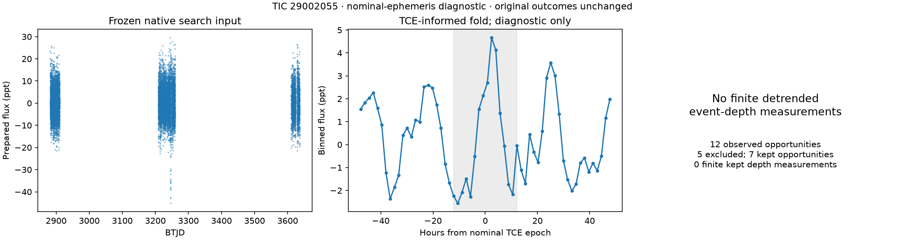
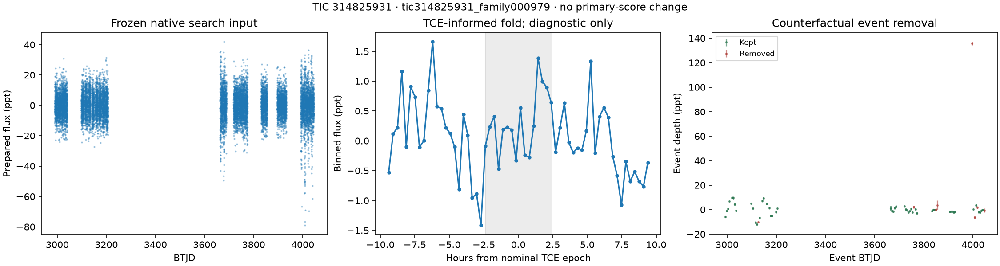
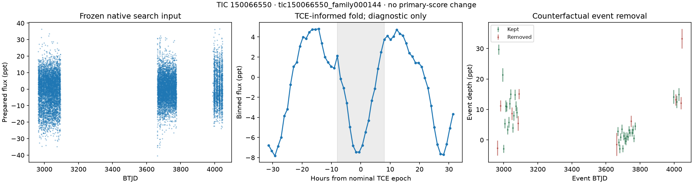
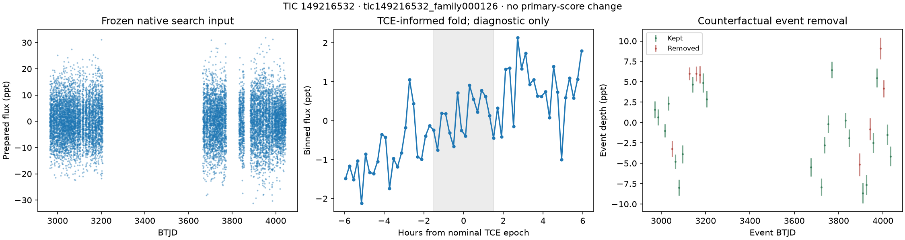

# P10.3 five required autopsies

[M] Both H rules fired. The locked selection contains the five highest expected-SNR INDEPENDENT likely-periodic in-band forced-present misses across the fired presets. Every selected family misses in both presets. Five one-attempt diagnostics completed with no unknowns. The original primary fits, searches and prediction locks were preserved.

[A] The new diagnostic uses the independent representative TCE period, nominal epoch and duration, with the one-cadence duration floor, in a fresh per-family root. It runs the unchanged preparation/event-census functions only. There is no new blind search, TLS fit, or primary Part F fit. The P9-style nominal-ephemeris A criteria are counterfactual; they cannot be recorded as actual Stage A losses. Best-phase primary presence is explicitly distinguished from nominal-epoch diagnostics.

[M] Four P10 autopsies have local internal-gate/selection witnesses; three have nominal durations wider than the 4.8-hour search maximum; four have uncheckable nominal epochs. The saved witnesses identify a shared selection contributor, not a demonstrated alternative recovery or a unique common cause. The proposed iteration is costed in `CALIBRATION_CHECK_P10_3.md` and is not executed.

## 1. TIC 353898013 · tic353898013_family001064

[M] The nominal TCE duration exceeds the search duration ceiling. Period-compatible BLS trials exist, but no saved log witness establishes a period-compatible internal-gate survivor losing final selection. The prepared light curve has a strong short-period rotation proxy. [I] Broad nominal duration, variability and uncertain phase are plausible contributors; no single causal mechanism is established for this case.

| Quantity | Recorded value |
|---|---|
| Representative source | tess2019199201929-s0014-s0016_dvr-tcestats.csv row 1649; s0014-s0016; pn 1 |
| TCE period / epoch | 29.4088 d / BTJD 1693.29 |
| Nominal duration / depth | 15.5633 h / 90795.8 ppm |
| DV model SNR / transit count | 17.9978 / 3 |
| Expected SNR | 938.5025114 |
| Primary presence | PRESENT |
| Primary fit phase mode | BEST_PHASE |
| Primary fitted depth significance | 14.6081037 |
| Epoch condition | {"checkable": false, "mode": "PERIOD_ONLY", "cycles": null, "accumulated_period_error_days": null, "half_duration_days": null, "reference_midpoint_btjd": 3244.0419519311686, "reason": "MISSING_OR_NONFINITE_EPHEMERIS_UNCERTAINTY"} |
| First actual termination | SEARCH_MATCHING |
| Diagnostic root | data/survey/p10/part3/autopsies_v1/tic353898013_family001064 |
| Autopsy result SHA256 | 55c90fff01387ad535d8a716ff9446613d34ba94de18944a213419b4ed74a84e |

### Nominal event census and counterfactual A criteria

| Metric | Count |
|---|---|
| n_predicted_in_span | 28 |
| n_observed | 15 |
| n_excluded | 4 |
| n_kept | 11 |

The predicted-in-span count includes gaps without observed coverage. Kept event opportunities need not have a finite detrended depth measurement. Removal classes can overlap within one event.

| Removal class | Observed events carrying class |
|---|---|
| momentum_dump | 2 |
| sector_orbit_edge | 1 |
| sap_baseline_ramp | 1 |
| pdc_gap | 2 |
| scattered_light_flag | 1 |

| Frozen native preparation counter | Value |
|---|---|
| n_unbinned | 152551 |
| n_after_deep_clip | 152551 |
| n_deep_clipped | 0 |
| deep_clip_threshold_ppt | 56.111 |
| mad_ppt | 5.611 |
| window_days | 0.75 |
| n_isolated_clipped | 0 |
| n_clipped_up | 790 |
| n_masked_quality | 36395 |
| n_products_dropped | 0 |

| Counterfactual criterion | Satisfied |
|---|---|
| kept_events_ge_3 | True |
| kept_snr_ge_7 | True |
| top_share_le_50pct | True |
| snr_without_top_ge_5 | True |
| depth_within_0.5_2x_survey | False |
| depths_consistent_p_ge_1e-3 | False |

| Counterfactual metric | Value |
|---|---|
| n_criteria_passed | 4 |
| all_passed | 0 |
| n_kept | 11 |
| kept_snr | 19.37 |
| top_event_share | 0.33 |
| snr_without_top | 11.99 |
| kept_depth_ppt | 6.959 |
| kept_depth_err_ppt | 0.359 |
| depth_over_survey_depth | 0.077 |
| p_const | 4.5209232e-11 |
| top_event_n | 42 |

[M] Rotation/variability proxy from the pre-exposure native-noise record: {"available": true, "peak_period_days": 1.6584935702517716, "peak_power": 0.6974814424993291, "semi_amplitude_ppt": 18.97574492524698, "n_cadences": 153341, "baseline_days": 837.5664632294229, "period_grid_days": [0.1, 30.0], "scatter_ppt": 18.1795807839673}. This proxy was not used to select the five misses.

### survey_p10: traces, selection, accepted aliases and budget

| Evidence | Value |
|---|---|
| BLS near-period/allowed-alias trial count | 14 |
| Broad-rank competitions | 10 |
| Local internal-gate/selection witnesses | 0 |
| Trace path | data/survey/p10/part3/runs/survey_p10/traces/tic353898013.jsonl |
| Trace SHA256 | 5ada9d4f3910cd1f97186536f30808f8e8c766dc4cf433b6a8a1999a05948292 |
| Search log path | p10/part3/results/controllers/search_survey_p10/logs/survey_p10_tic353898013.log |
| Search log SHA256 | 051dcbd06b4fd150bfade16dab32dd2cdcd4534351d7ea0a5225f3aaae62f234 |

[A] BLS rank competition alone does not establish internal-gate passage. The following log witnesses require both a locally period-compatible gate passer and selection of a different period. They do not establish the epoch or a globally accepted alternative result.

[M] No qualifying saved final-selection witness.

| Trace line | Partition | Pass | Trial period d | Alias | BLS SNR | Peak rank |
|---|---|---|---|---|---|---|
| 67 | chunk0 | 59 | 14.790098603122434 | 1:2 | 20.84 | 2 |
| 68 | chunk0 | 60 | 9.860065735414956 | 1:3 | 16.5 | 2 |
| 198 | chunk1 | 65 | 14.68913245311087 | 1:2 | 19.75 | 1 |
| 199 | chunk1 | 66 | 9.710237938521136 | 1:3 | 15.76 | 2 |
| 267 | stitch | 13 | 14.70105817023307 | 1:2 | 21.74 | 1 |
| 298 | stitch | 33 | 14.739883096075495 | 1:2 | 19.77 | 2 |
| 299 | stitch | 34 | 29.597013041649134 | 1:1 | 16.3 | 2 |
| 348 | stitch | 65 | 14.599039785759956 | 1:2 | 19.32 | 2 |
| 349 | stitch | 66 | 29.59851632047477 | 1:1 | 10.29 | 2 |
| 379 | stitch | 85 | 14.599039785759956 | 1:2 | 21.37 | 2 |
| 380 | stitch | 86 | 29.59851632047477 | 1:1 | 13.4 | 2 |
| 400 | stitch | 99 | 29.35849143023653 | 1:1 | 21.85 | 1 |
| 407 | stitch | 103 | 14.744110538666096 | 1:2 | 20.49 | 1 |
| 408 | stitch | 104 | 29.35798425603844 | 1:1 | 21.67 | 2 |

[M] No accepted candidate has a registered period/alias association with this representative independent ephemeris.

| Detector-budget field | Exhausted |
|---|---|
| /searches/0/budget_exhausted | False |
| /searches/1/budget_exhausted | False |
| /searches/2/budget_exhausted | False |

| Log line | Stop/budget message |
|---|---|
| 268 | 2026-09-15 05:10:04,262 tesshunter.pipeline WARNING Detection stopped after planet 1: masking P=1.6579 d (width_factor=7) would remove 100% of cadences |
| 572 | 2026-09-15 05:12:58,184 tesshunter.pipeline WARNING Detection stopped after planet 1: masking P=1.6580 d (width_factor=7) would remove 100% of cadences |

### survey_p8: traces, selection, accepted aliases and budget

| Evidence | Value |
|---|---|
| BLS near-period/allowed-alias trial count | 1 |
| Broad-rank competitions | 0 |
| Local internal-gate/selection witnesses | 0 |
| Trace path | data/survey/p10/part3/runs/survey_p8/traces/tic353898013.jsonl |
| Trace SHA256 | 35d86ff89e5419573b1fd2f0ff9f933977a38dd131dbadca7ca6bab3f658599b |
| Search log path | p10/part3/results/controllers/search_survey_p8/logs/survey_p8_tic353898013.log |
| Search log SHA256 | 8da9eb48f5c343573362bfadc6304385305e2f42576e65f884c5521ac0f16dee |

[A] BLS rank competition alone does not establish internal-gate passage. The following log witnesses require both a locally period-compatible gate passer and selection of a different period. They do not establish the epoch or a globally accepted alternative result.

[M] No qualifying saved final-selection witness.

| Trace line | Partition | Pass | Trial period d | Alias | BLS SNR | Peak rank |
|---|---|---|---|---|---|---|
| 152 | stitch | 13 | 14.70105817023307 | 1:2 | 21.74 | 1 |

[M] No accepted candidate has a registered period/alias association with this representative independent ephemeris.

| Detector-budget field | Exhausted |
|---|---|
| /searches/0/budget_exhausted | False |
| /searches/1/budget_exhausted | False |
| /searches/2/budget_exhausted | False |

| Log line | Stop/budget message |
|---|---|
| 147 | 2026-09-15 08:23:25,620 tesshunter.pipeline WARNING Detection stopped after planet 1: masking P=1.6579 d (width_factor=7) would remove 100% of cadences |
| 319 | 2026-09-15 08:25:12,126 tesshunter.pipeline WARNING Detection stopped after planet 1: masking P=1.6580 d (width_factor=7) would remove 100% of cadences |

[M] Display plots use saved arrays and measurements only. The fold is TCE-informed and diagnostic. The TIC 29002055 display copy explicitly annotates its empty detrended-depth panel; the sealed original plot remains unchanged.

## 2. TIC 29002055 · tic29002055_family000007

[M] P10 recorded a local 2.8856-day (1:3) internal-gate passer at composite 19.46, while that pass selected 1.926697 d at composite 42.97. There are seven kept nominal event opportunities, but none has a finite detrended depth measurement. The nominal duration is 24.2536 hours. [I] Ranking competition and the mismatch between the broad nominal box and the search duration range both matter diagnostically; a globally matching alternative recovery has not been measured.

| Quantity | Recorded value |
|---|---|
| Representative source | tess2019307033525-s0018-s0018_dvr-tcestats.csv row 33; s0018; pn 1 |
| TCE period / epoch | 8.730399999999998 d / BTJD 1790.98 |
| Nominal duration / depth | 24.2536 h / 61432.9 ppm |
| DV model SNR / transit count | 12.66893 / 3 |
| Expected SNR | 605.2487499 |
| Primary presence | PRESENT |
| Primary fit phase mode | BEST_PHASE |
| Primary fitted depth significance | 4.93987952 |
| Epoch condition | {"checkable": false, "mode": "PERIOD_ONLY", "cycles": null, "accumulated_period_error_days": null, "half_duration_days": null, "reference_midpoint_btjd": 3259.191958522417, "reason": "MISSING_OR_NONFINITE_EPHEMERIS_UNCERTAINTY"} |
| First actual termination | SEARCH_MATCHING |
| Diagnostic root | data/survey/p10/part3/autopsies_v1/tic29002055_family000007 |
| Autopsy result SHA256 | a934e7b40f4fb6f1381516289e1a8e95d2ff0b114f483db2eec48896d3de590d |

### Nominal event census and counterfactual A criteria

| Metric | Count |
|---|---|
| n_predicted_in_span | 86 |
| n_observed | 12 |
| n_excluded | 5 |
| n_kept | 7 |

The predicted-in-span count includes gaps without observed coverage. Kept event opportunities need not have a finite detrended depth measurement. Removal classes can overlap within one event.

| Removal class | Observed events carrying class |
|---|---|
| momentum_dump | 3 |
| pdc_gap | 3 |
| scattered_light_flag | 2 |
| scattered_light_ramp | 1 |

| Frozen native preparation counter | Value |
|---|---|
| n_unbinned | 37949 |
| n_after_deep_clip | 37949 |
| n_deep_clipped | 0 |
| deep_clip_threshold_ppt | 67.272 |
| mad_ppt | 6.727 |
| window_days | 0.75 |
| n_isolated_clipped | 0 |
| n_clipped_up | 108 |
| n_masked_quality | 6053 |
| n_products_dropped | 0 |

| Counterfactual criterion | Satisfied |
|---|---|
| kept_events_ge_3 | False |
| kept_snr_ge_7 | False |
| top_share_le_50pct | False |
| snr_without_top_ge_5 | False |
| depth_within_0.5_2x_survey | False |
| depths_consistent_p_ge_1e-3 | False |

| Counterfactual metric | Value |
|---|---|
| n_criteria_passed | 0 |
| all_passed | 0 |
| n_kept | 0 |
| kept_snr | unmeasured |
| top_event_share | unmeasured |
| snr_without_top | unmeasured |
| kept_depth_ppt | unmeasured |
| kept_depth_err_ppt | unmeasured |
| depth_over_survey_depth | unmeasured |
| p_const | unmeasured |
| top_event_n | unmeasured |

[M] Rotation/variability proxy from the pre-exposure native-noise record: {"available": true, "peak_period_days": 1.9277692987388544, "peak_power": 0.6976177185664273, "semi_amplitude_ppt": 25.58489993554725, "n_cadences": 38057, "baseline_days": 753.7138226889565, "period_grid_days": [0.1, 30.0], "scatter_ppt": 24.967155078748693}. This proxy was not used to select the five misses.

### survey_p10: traces, selection, accepted aliases and budget

| Evidence | Value |
|---|---|
| BLS near-period/allowed-alias trial count | 28 |
| Broad-rank competitions | 11 |
| Local internal-gate/selection witnesses | 4 |
| Trace path | data/survey/p10/part3/runs/survey_p10/traces/tic29002055.jsonl |
| Trace SHA256 | 67b03ea99c41099c2b7437feb04a5f436e4defa8b3b3622e1e4bfdd1468e54c4 |
| Search log path | p10/part3/results/controllers/search_survey_p10/logs/survey_p10_tic29002055.log |
| Search log SHA256 | d83976e405c4a446a4c9ffebd1188ae684f2fb251639d2d7eaf279239c3fd622 |

[A] BLS rank competition alone does not establish internal-gate passage. The following log witnesses require both a locally period-compatible gate passer and selection of a different period. They do not establish the epoch or a globally accepted alternative result.

| Partition | Pass | Trial log line | Local period d | Alias | Local composite | Chosen log line | Chosen period d | Chosen composite |
|---|---|---|---|---|---|---|---|---|
| chunk0 | 1 | 167 | 2.8856 | 1:3 | 19.46 | 249 | 1.926697 | 42.97 |
| stitch | 4 | 999 | 17.461 | 2:1 | 20.58 | 1000 | 11.50838 | 24.52 |
| stitch | 5 | 1024 | 17.4607 | 2:1 | 18.31 | 1082 | 14.424235 | 19.91 |
| stitch | 6 | 1114 | 17.3569 | 2:1 | 13.55 | 1156 | 11.569608 | 18.74 |

| Trace line | Partition | Pass | Trial period d | Alias | BLS SNR | Peak rank |
|---|---|---|---|---|---|---|
| 1 | chunk0 | 1 | 2.8857381191901545 | 1:3 | 19.43 | 4 |
| 1 | chunk0 | 1 | 8.813211763336536 | 1:1 | 10.71 | 11 |
| 27 | chunk0 | 24 | 2.8857526131033597 | 1:3 | 19.46 | 1 |
| 34 | chunk0 | 30 | 2.886101485944687 | 1:3 | 19.41 | 1 |
| 40 | chunk0 | 35 | 4.3777673727933175 | 1:2 | 10.17 | 2 |
| 56 | chunk0 | 49 | 2.906367924976035 | 1:3 | 18.27 | 1 |
| 75 | chunk0 | 65 | 4.374985726767896 | 1:2 | 10.19 | 1 |
| 76 | chunk0 | 66 | 2.8855768381714646 | 1:3 | 19.46 | 1 |
| 108 | chunk0 | 94 | 2.913527558496461 | 1:3 | 18.08 | 1 |
| 110 | chunk0 | 96 | 8.723900582397503 | 1:1 | 13.26 | 2 |
| 244 | chunk2 | 4 | 2.888490024119112 | 1:3 | 17.76 | 1 |
| 270 | chunk2 | 26 | 2.8894579505796854 | 1:3 | 17.62 | 1 |
| 294 | chunk2 | 47 | 2.8887614510206525 | 1:3 | 17.74 | 1 |
| 299 | chunk2 | 51 | 2.888692194993102 | 1:3 | 17.78 | 1 |
| 322 | chunk2 | 71 | 2.888412500964508 | 1:3 | 17.76 | 1 |
| 326 | chunk2 | 75 | 8.648696054954435 | 1:1 | 14.26 | 2 |
| 343 | chunk2 | 89 | 2.8884180161075625 | 1:3 | 17.76 | 1 |
| 344 | chunk2 | 90 | 4.389534248704691 | 1:2 | 12.26 | 2 |
| 363 | stitch | 7 | 17.360520094562645 | 2:1 | 22.82 | 2 |
| 494 | stitch | 91 | 17.461013406717246 | 2:1 | 21.58 | 1 |
| 497 | stitch | 93 | 17.45897268795545 | 2:1 | 19.27 | 3 |
| 497 | stitch | 93 | 26.220304297535368 | 3:1 | 14.7 | 15 |
| 504 | stitch | 98 | 17.46073141357583 | 2:1 | 19.23 | 1 |
| 533 | stitch | 116 | 17.55696347837842 | 2:1 | 16.2 | 2 |
| 542 | stitch | 122 | 26.034985422740522 | 3:1 | 12.3 | 13 |
| 547 | stitch | 126 | 26.032787615203077 | 3:1 | 12.34 | 2 |
| 552 | stitch | 129 | 26.31944030961596 | 3:1 | 11.21 | 2 |
| 554 | stitch | 130 | 17.356866707845015 | 2:1 | 14.23 | 1 |

[M] No accepted candidate has a registered period/alias association with this representative independent ephemeris.

| Detector-budget field | Exhausted |
|---|---|
| /searches/0/budget_exhausted | False |
| /searches/1/budget_exhausted | False |
| /searches/2/budget_exhausted | False |
| /searches/3/budget_exhausted | False |

| Log line | Stop/budget message |
|---|---|
| 251 | 2026-09-15 04:11:36,250 tesshunter.pipeline WARNING Detection stopped after planet 1: masking P=1.9267 d (width_factor=7) would remove 100% of cadences |
| 500 | 2026-09-15 04:11:54,694 tesshunter.pipeline WARNING Detection stopped after planet 1: masking P=1.9288 d (width_factor=7) would remove 100% of cadences |
| 730 | 2026-09-15 04:12:05,716 tesshunter.pipeline WARNING Detection stopped after planet 1: masking P=1.9410 d (width_factor=7) would remove 100% of cadences |

### survey_p8: traces, selection, accepted aliases and budget

| Evidence | Value |
|---|---|
| BLS near-period/allowed-alias trial count | 8 |
| Broad-rank competitions | 3 |
| Local internal-gate/selection witnesses | 0 |
| Trace path | data/survey/p10/part3/runs/survey_p8/traces/tic29002055.jsonl |
| Trace SHA256 | 2e4b0ad7c334fe0170f9d5198536310657a8123ced351571f16b2711443340a6 |
| Search log path | p10/part3/results/controllers/search_survey_p8/logs/survey_p8_tic29002055.log |
| Search log SHA256 | 85251562170d5cd879ace3f09c414b7520ba01b925233bfddd198fffdfc95a88 |

[A] BLS rank competition alone does not establish internal-gate passage. The following log witnesses require both a locally period-compatible gate passer and selection of a different period. They do not establish the epoch or a globally accepted alternative result.

[M] No qualifying saved final-selection witness.

| Trace line | Partition | Pass | Trial period d | Alias | BLS SNR | Peak rank |
|---|---|---|---|---|---|---|
| 1 | chunk0 | 1 | 2.8857381191901545 | 1:3 | 19.43 | 4 |
| 27 | chunk0 | 24 | 2.8857526131033597 | 1:3 | 19.46 | 1 |
| 34 | chunk0 | 30 | 2.886101485944687 | 1:3 | 19.41 | 1 |
| 40 | chunk0 | 35 | 4.3777673727933175 | 1:2 | 10.17 | 2 |
| 123 | chunk2 | 4 | 2.888490024119112 | 1:3 | 17.76 | 1 |
| 149 | chunk2 | 26 | 2.8894579505796854 | 1:3 | 17.62 | 1 |
| 171 | chunk2 | 45 | 2.888692194993102 | 1:3 | 17.78 | 1 |
| 188 | stitch | 7 | 17.360520094562645 | 2:1 | 22.82 | 2 |

[M] No accepted candidate has a registered period/alias association with this representative independent ephemeris.

| Detector-budget field | Exhausted |
|---|---|
| /searches/0/budget_exhausted | False |
| /searches/1/budget_exhausted | False |
| /searches/2/budget_exhausted | False |
| /searches/3/budget_exhausted | False |

| Log line | Stop/budget message |
|---|---|
| 131 | 2026-09-15 08:00:17,857 tesshunter.pipeline WARNING Detection stopped after planet 1: masking P=1.9263 d (width_factor=7) would remove 100% of cadences |
| 259 | 2026-09-15 08:00:29,818 tesshunter.pipeline WARNING Detection stopped after planet 1: masking P=1.9288 d (width_factor=7) would remove 100% of cadences |
| 386 | 2026-09-15 08:00:36,547 tesshunter.pipeline WARNING Detection stopped after planet 1: masking P=1.9413 d (width_factor=7) would remove 100% of cadences |

[M] Display plots use saved arrays and measurements only. The fold is TCE-informed and diagnostic. The TIC 29002055 display copy explicitly annotates its empty detrended-depth panel; the sealed original plot remains unchanged.

## 3. TIC 314825931 · tic314825931_family000979

[M] A P10 local 16.7679-day (3:1) internal-gate passer at composite 12.87 lost to 28.567457 d at composite 24.8. The P8 chunk1 search exhausted its detector budget. The nominal-event kept depth is negative and inconsistent. [I] This supports a local ranking-loss witness, while phase uncertainty and structured variability prevent interpreting the nominal-event audit as proof of a missed stable transit.

| Quantity | Recorded value |
|---|---|
| Representative source | tess2020187183116-s0027-s0027_dvr-tcestats.csv row 736; s0027; pn 1 |
| TCE period / epoch | 5.60456 d / BTJD 2039.44 |
| Nominal duration / depth | 4.77554 h / 48138.7 ppm |
| DV model SNR / transit count | 27.24876 / 4 |
| Expected SNR | 401.0393592 |
| Primary presence | PRESENT |
| Primary fit phase mode | BEST_PHASE |
| Primary fitted depth significance | 11.2629693 |
| Epoch condition | {"checkable": false, "mode": "PERIOD_ONLY", "cycles": 263.7963845708031, "accumulated_period_error_days": 0.6455440465747495, "half_duration_days": 0.09949041666666668, "reference_midpoint_btjd": 3517.9026651101403, "reason": "UNCERTAINTY_NOT_SMALL_ENOUGH"} |
| First actual termination | SEARCH_MATCHING |
| Diagnostic root | data/survey/p10/part3/autopsies_v1/tic314825931_family000979 |
| Autopsy result SHA256 | 0b18e5bc09c0d6f19722076df40bff7d6f9c369b6ba35e5ac9c3025975725cb0 |

### Nominal event census and counterfactual A criteria

| Metric | Count |
|---|---|
| n_predicted_in_span | 189 |
| n_observed | 65 |
| n_excluded | 16 |
| n_kept | 49 |

The predicted-in-span count includes gaps without observed coverage. Kept event opportunities need not have a finite detrended depth measurement. Removal classes can overlap within one event.

| Removal class | Observed events carrying class |
|---|---|
| scattered_light_ramp | 6 |
| scattered_light_flag | 6 |
| momentum_dump | 2 |
| sector_orbit_edge | 4 |
| quality_flagged | 5 |
| sap_baseline_ramp | 2 |

| Frozen native preparation counter | Value |
|---|---|
| n_unbinned | 129948 |
| n_after_deep_clip | 129842 |
| n_deep_clipped | 106 |
| deep_clip_threshold_ppt | 81.617 |
| mad_ppt | 8.162 |
| window_days | 0.75 |
| n_isolated_clipped | 6 |
| n_clipped_up | 955 |
| n_masked_quality | 23251 |
| n_products_dropped | 0 |

| Counterfactual criterion | Satisfied |
|---|---|
| kept_events_ge_3 | True |
| kept_snr_ge_7 | False |
| top_share_le_50pct | True |
| snr_without_top_ge_5 | False |
| depth_within_0.5_2x_survey | False |
| depths_consistent_p_ge_1e-3 | False |

| Counterfactual metric | Value |
|---|---|
| n_criteria_passed | 2 |
| all_passed | 0 |
| n_kept | 49 |
| kept_snr | -3.25 |
| top_event_share | 0.23 |
| snr_without_top | -4.9 |
| kept_depth_ppt | -0.396 |
| kept_depth_err_ppt | 0.122 |
| depth_over_survey_depth | -0.008 |
| p_const | 2.054426e-12 |
| top_event_n | 175 |

[M] Rotation/variability proxy from the pre-exposure native-noise record: {"available": true, "peak_period_days": 0.7915892079885898, "peak_power": 0.01271916152502937, "semi_amplitude_ppt": 2.2385126902581596, "n_cadences": 130909, "baseline_days": 1055.9032872031553, "period_grid_days": [0.1, 30.0], "scatter_ppt": 8.291844498988342}. This proxy was not used to select the five misses.

### survey_p10: traces, selection, accepted aliases and budget

| Evidence | Value |
|---|---|
| BLS near-period/allowed-alias trial count | 17 |
| Broad-rank competitions | 14 |
| Local internal-gate/selection witnesses | 3 |
| Trace path | data/survey/p10/part3/runs/survey_p10/traces/tic314825931.jsonl |
| Trace SHA256 | 2d7c4908dbe5793af0e8116b812f2b803bc9dfbd067a1f070f320ab3891d3b25 |
| Search log path | p10/part3/results/controllers/search_survey_p10/logs/survey_p10_tic314825931.log |
| Search log SHA256 | 7f543e3c868e3bfba1dc9cf6c3c30acf4d551608e52fa59f4480e4c86a0fdaac |

[A] BLS rank competition alone does not establish internal-gate passage. The following log witnesses require both a locally period-compatible gate passer and selection of a different period. They do not establish the epoch or a globally accepted alternative result.

| Partition | Pass | Trial log line | Local period d | Alias | Local composite | Chosen log line | Chosen period d | Chosen composite |
|---|---|---|---|---|---|---|---|---|
| chunk1 | 1 | 444 | 16.7679 | 3:1 | 12.87 | 583 | 28.567457 | 24.8 |
| chunk1 | 2 | 806 | 16.9425 | 3:1 | 12.08 | 866 | 0.791322 | 12.62 |
| stitch | 4 | 1158 | 11.1443 | 2:1 | 11.0 | 1164 | 26.093494 | 16.21 |

| Trace line | Partition | Pass | Trial period d | Alias | BLS SNR | Peak rank |
|---|---|---|---|---|---|---|
| 17 | chunk0 | 15 | 1.8801160118735551 | 1:3 | 3.543 | 2 |
| 24 | chunk0 | 22 | 11.268511959089667 | 2:1 | 9.989 | 2 |
| 85 | chunk0 | 75 | 2.81756247765788 | 1:2 | 6.358 | 2 |
| 126 | chunk1 | 1 | 16.767788273433574 | 3:1 | 18.36 | 8 |
| 153 | chunk1 | 24 | 11.225148976360204 | 2:1 | 12.78 | 2 |
| 155 | chunk1 | 26 | 5.589207550350413 | 1:1 | 11.98 | 2 |
| 162 | chunk1 | 32 | 1.8529034087712781 | 1:3 | 11.53 | 2 |
| 184 | chunk1 | 52 | 16.76787249135559 | 3:1 | 18.39 | 1 |
| 227 | chunk1 | 89 | 1.8704400730474335 | 1:3 | 8.242 | 2 |
| 229 | chunk1 | 91 | 5.620798452538567 | 1:1 | 10.6 | 2 |
| 308 | chunk1 | 159 | 16.911847961601328 | 3:1 | 15.81 | 2 |
| 334 | chunk1 | 182 | 16.942498209450214 | 3:1 | 17.26 | 1 |
| 353 | chunk1 | 198 | 1.8790453005827672 | 1:3 | 7.855 | 2 |
| 370 | stitch | 6 | 11.279814450379531 | 2:1 | 8.546 | 2 |
| 410 | stitch | 32 | 11.279814450379531 | 2:1 | 9.092 | 2 |
| 478 | stitch | 76 | 16.861996206990916 | 3:1 | 14.03 | 2 |
| 496 | stitch | 87 | 11.144337926252838 | 2:1 | 17.23 | 1 |

[M] No accepted candidate has a registered period/alias association with this representative independent ephemeris.

| Detector-budget field | Exhausted |
|---|---|
| /searches/0/budget_exhausted | False |
| /searches/1/budget_exhausted | False |
| /searches/2/budget_exhausted | False |

| Log line | Stop/budget message |
|---|---|
| 297 | 2026-09-15 05:26:31,037 tesshunter.pipeline WARNING Detection stopped after planet 1: masking P=0.7908 d (width_factor=7) would remove 100% of cadences |
| 868 | 2026-09-15 05:29:58,326 tesshunter.pipeline WARNING Detection stopped after planet 2: masking P=0.7913 d (width_factor=7) would remove 100% of cadences |

### survey_p8: traces, selection, accepted aliases and budget

| Evidence | Value |
|---|---|
| BLS near-period/allowed-alias trial count | 8 |
| Broad-rank competitions | 8 |
| Local internal-gate/selection witnesses | 0 |
| Trace path | data/survey/p10/part3/runs/survey_p8/traces/tic314825931.jsonl |
| Trace SHA256 | d5f0ea8d84e3930f26ea8140ecadb0c83c18b225b19f9e90249829a53584207b |
| Search log path | p10/part3/results/controllers/search_survey_p8/logs/survey_p8_tic314825931.log |
| Search log SHA256 | 5e4bf5c5304de3e1e3e7b11661bb6142cf6d91324e46a4e1c676f417faa464fb |

[A] BLS rank competition alone does not establish internal-gate passage. The following log witnesses require both a locally period-compatible gate passer and selection of a different period. They do not establish the epoch or a globally accepted alternative result.

[M] No qualifying saved final-selection witness.

| Trace line | Partition | Pass | Trial period d | Alias | BLS SNR | Peak rank |
|---|---|---|---|---|---|---|
| 17 | chunk0 | 15 | 1.8801160118735551 | 1:3 | 3.543 | 2 |
| 24 | chunk0 | 22 | 11.268511959089667 | 2:1 | 9.989 | 2 |
| 94 | chunk1 | 24 | 11.225148976360204 | 2:1 | 12.78 | 2 |
| 96 | chunk1 | 26 | 5.589207550350413 | 1:1 | 11.98 | 2 |
| 103 | chunk1 | 32 | 1.8529034087712781 | 1:3 | 11.53 | 2 |
| 193 | stitch | 6 | 11.279814450379531 | 2:1 | 8.546 | 2 |
| 220 | stitch | 24 | 11.279814450379531 | 2:1 | 9.092 | 2 |
| 235 | stitch | 34 | 11.28616033755274 | 2:1 | 9.348 | 2 |

[M] No accepted candidate has a registered period/alias association with this representative independent ephemeris.

| Detector-budget field | Exhausted |
|---|---|
| /searches/0/budget_exhausted | False |
| /searches/1/budget_exhausted | True |
| /searches/2/budget_exhausted | False |

| Log line | Stop/budget message |
|---|---|
| 171 | 2026-09-15 08:29:43,810 tesshunter.pipeline WARNING Detection stopped after planet 1: masking P=0.7908 d (width_factor=7) would remove 100% of cadences |

[M] Display plots use saved arrays and measurements only. The fold is TCE-informed and diagnostic. The TIC 29002055 display copy explicitly annotates its empty detrended-depth panel; the sealed original plot remains unchanged.

## 4. TIC 150066550 · tic150066550_family000144

[M] P10 local allowed-alias candidates lost to a 1.194001-day (1:5, outside the allowed alias set) winner. An accepted P10 candidate is period-compatible at 2:1 but fails the registered epoch test: phase distance 0.748600251 d exceeds T14/2 = 0.332508333 d, with accumulated period error 0.299879780 d making the epoch check applicable. P8 also has local selection witnesses. [I] A period-only alternative would change the registered rule; it is not credited. Nominal-event depth dilution and a duration wider than the search maximum are additional diagnostics.

| Quantity | Recorded value |
|---|---|
| Representative source | tess2018206190142-s0001-s0036_dvr-tcestats.csv row 5505; s0001-s0036; pn 3 |
| TCE period / epoch | 5.97144 d / BTJD 2062.72 |
| Nominal duration / depth | 15.9604 h / 23995.0 ppm |
| DV model SNR / transit count | 20.1193 / 27 |
| Expected SNR | 294.732464 |
| Primary presence | PRESENT |
| Primary fit phase mode | FIXED_CHECKABLE_EPOCH |
| Primary fitted depth significance | 33.9039273 |
| Epoch condition | {"checkable": true, "mode": "EPOCH_CHECKED", "cycles": 241.522994493667, "accumulated_period_error_days": 0.2998797804232268, "half_duration_days": 0.33250833333333335, "reference_midpoint_btjd": 3504.9600702392627, "reason": "UNCERTAINTY_SMALL_ENOUGH"} |
| First actual termination | SEARCH_MATCHING |
| Diagnostic root | data/survey/p10/part3/autopsies_v1/tic150066550_family000144 |
| Autopsy result SHA256 | 64093153ce7f31551a1623f753f5f9e05df89287dfa51f469a532c116596fa4e |

### Nominal event census and counterfactual A criteria

| Metric | Count |
|---|---|
| n_predicted_in_span | 182 |
| n_observed | 51 |
| n_excluded | 16 |
| n_kept | 35 |

The predicted-in-span count includes gaps without observed coverage. Kept event opportunities need not have a finite detrended depth measurement. Removal classes can overlap within one event.

| Removal class | Observed events carrying class |
|---|---|
| pdc_gap | 3 |
| scattered_light_flag | 7 |
| scattered_light_ramp | 6 |
| dip_absent_in_sap | 2 |
| momentum_dump | 8 |
| sector_orbit_edge | 3 |
| quality_flagged | 1 |
| sap_baseline_ramp | 2 |

| Frozen native preparation counter | Value |
|---|---|
| n_unbinned | 109401 |
| n_after_deep_clip | 109401 |
| n_deep_clipped | 0 |
| deep_clip_threshold_ppt | 89.863 |
| mad_ppt | 8.986 |
| window_days | 0.75 |
| n_isolated_clipped | 2 |
| n_clipped_up | 394 |
| n_masked_quality | 16305 |
| n_products_dropped | 0 |

| Counterfactual criterion | Satisfied |
|---|---|
| kept_events_ge_3 | True |
| kept_snr_ge_7 | True |
| top_share_le_50pct | True |
| snr_without_top_ge_5 | True |
| depth_within_0.5_2x_survey | False |
| depths_consistent_p_ge_1e-3 | True |

| Counterfactual metric | Value |
|---|---|
| n_criteria_passed | 5 |
| all_passed | 0 |
| n_kept | 35 |
| kept_snr | 18.55 |
| top_event_share | 0.32 |
| snr_without_top | 15.98 |
| kept_depth_ppt | 4.643 |
| kept_depth_err_ppt | 0.25 |
| depth_over_survey_depth | 0.193 |
| p_const | 0.11390388 |
| top_event_n | 152 |

[M] Rotation/variability proxy from the pre-exposure native-noise record: {"available": true, "peak_period_days": 1.1959026327119642, "peak_power": 0.2839183575964539, "semi_amplitude_ppt": 11.264514239901327, "n_cadences": 109797, "baseline_days": 1081.8251900014034, "period_grid_days": [0.1, 30.0], "scatter_ppt": 12.948581595771774}. This proxy was not used to select the five misses.

### survey_p10: traces, selection, accepted aliases and budget

| Evidence | Value |
|---|---|
| BLS near-period/allowed-alias trial count | 74 |
| Broad-rank competitions | 15 |
| Local internal-gate/selection witnesses | 4 |
| Trace path | data/survey/p10/part3/runs/survey_p10/traces/tic150066550.jsonl |
| Trace SHA256 | 65cfe1fda1d4cbe2461cdcecaeea475098cc18eeb090ebdfd72603a90f10b17a |
| Search log path | p10/part3/results/controllers/search_survey_p10/logs/survey_p10_tic150066550.log |
| Search log SHA256 | 271e00c49ac73f80e77781cbc455f6c002dbb89fd175efa7dd8977b5018b046e |

[A] BLS rank competition alone does not establish internal-gate passage. The following log witnesses require both a locally period-compatible gate passer and selection of a different period. They do not establish the epoch or a globally accepted alternative result.

| Partition | Pass | Trial log line | Local period d | Alias | Local composite | Chosen log line | Chosen period d | Chosen composite |
|---|---|---|---|---|---|---|---|---|
| chunk0 | 1 | 208 | 11.9413 | 2:1 | 46.71 | 259 | 1.194001 | 161.24 |
| chunk0 | 1 | 258 | 2.9849 | 1:2 | 16.07 | 259 | 1.194001 | 161.24 |
| chunk1 | 1 | 338 | 2.9868 | 1:2 | 7.02 | 519 | 0.597222 | 13.95 |
| chunk1 | 1 | 438 | 18.0402 | 3:1 | 7.52 | 519 | 0.597222 | 13.95 |
| chunk2 | 1 | 715 | 11.9321 | 2:1 | 17.87 | 774 | 1.194417 | 41.5 |
| stitch | 5 | 1114 | 12.018 | 2:1 | 17.75 | 1144 | 16.77898 | 20.44 |

| Trace line | Partition | Pass | Trial period d | Alias | BLS SNR | Peak rank |
|---|---|---|---|---|---|---|
| 1 | chunk0 | 1 | 5.971455728013297 | 1:1 | 64.51 | 3 |
| 18 | chunk0 | 16 | 2.9849462598537673 | 1:2 | 30.69 | 1 |
| 23 | chunk0 | 21 | 5.971485720257034 | 1:1 | 64.54 | 1 |
| 24 | chunk0 | 22 | 11.94057253091469 | 2:1 | 46.75 | 1 |
| 25 | chunk0 | 23 | 17.914457160771104 | 3:1 | 38.21 | 1 |
| 66 | chunk0 | 59 | 2.984910586050971 | 1:2 | 30.55 | 1 |
| 91 | chunk0 | 80 | 11.941294945951364 | 2:1 | 46.71 | 1 |
| 93 | chunk0 | 82 | 5.970647472975682 | 1:1 | 64.46 | 1 |
| 101 | chunk0 | 89 | 5.970693743472375 | 1:1 | 64.45 | 1 |
| 105 | chunk0 | 92 | 11.904464285714285 | 2:1 | 30.39 | 2 |
| 107 | chunk0 | 94 | 5.9522321428571425 | 1:1 | 42.38 | 1 |
| 120 | chunk0 | 105 | 2.9849316441722085 | 1:2 | 30.69 | 1 |
| 123 | chunk1 | 1 | 2.9865824429361827 | 1:2 | 10.88 | 3 |
| 123 | chunk1 | 1 | 18.047375545194765 | 3:1 | 9.008 | 10 |
| 141 | chunk1 | 17 | 2.986682248525106 | 1:2 | 10.75 | 1 |
| 142 | chunk1 | 18 | 5.973194886700521 | 1:1 | 8.927 | 1 |
| 149 | chunk1 | 24 | 2.9868234735218886 | 1:2 | 10.67 | 1 |
| 152 | chunk1 | 26 | 5.972878995871003 | 1:1 | 8.802 | 1 |
| 154 | chunk1 | 28 | 2.9867856231504315 | 1:2 | 10.68 | 1 |
| 185 | chunk1 | 55 | 5.973150188759668 | 1:1 | 8.938 | 1 |
| 187 | chunk1 | 57 | 2.98667422680931 | 1:2 | 10.69 | 1 |
| 194 | chunk1 | 63 | 5.973816323231626 | 1:1 | 8.888 | 1 |
| 197 | chunk1 | 66 | 2.986545871293378 | 1:2 | 10.76 | 1 |
| 198 | chunk1 | 67 | 18.040217483802707 | 3:1 | 9.025 | 1 |
| 218 | chunk1 | 84 | 5.973296311140571 | 1:1 | 8.823 | 1 |
| 243 | chunk2 | 1 | 5.966722876487988 | 1:1 | 21.34 | 5 |
| 275 | chunk2 | 29 | 2.9863762982192936 | 1:2 | 14.38 | 1 |
| 280 | chunk2 | 34 | 5.959569034973587 | 1:1 | 21.33 | 1 |
| 281 | chunk2 | 35 | 11.935903661525519 | 2:1 | 17.86 | 1 |
| 282 | chunk2 | 36 | 17.864368292205036 | 3:1 | 16.35 | 1 |
| 303 | chunk2 | 54 | 2.986506481487475 | 1:2 | 14.39 | 1 |
| 330 | chunk2 | 77 | 11.932125191490048 | 2:1 | 17.87 | 1 |
| 332 | chunk2 | 79 | 5.958876732937743 | 1:1 | 21.42 | 1 |
| 344 | chunk2 | 89 | 11.90487595313243 | 2:1 | 16.95 | 2 |
| 346 | chunk2 | 91 | 5.952437976566215 | 1:1 | 20.81 | 1 |
| 352 | chunk2 | 96 | 2.9851680946893415 | 1:2 | 14.41 | 1 |
| 357 | chunk2 | 101 | 17.85686949941624 | 3:1 | 16.37 | 1 |
| 367 | stitch | 1 | 11.944352434580985 | 2:1 | 50.58 | 1 |
| 367 | stitch | 1 | 17.937323826894378 | 3:1 | 41.05 | 7 |
| 368 | stitch | 2 | 11.94437240507494 | 2:1 | 50.45 | 1 |
| 384 | stitch | 12 | 17.916932907150795 | 3:1 | 40.79 | 1 |
| 391 | stitch | 16 | 11.943860562350327 | 2:1 | 50.56 | 1 |
| 394 | stitch | 18 | 11.899120050282841 | 2:1 | 31.75 | 2 |
| 403 | stitch | 24 | 11.924589042493627 | 2:1 | 45.77 | 1 |
| 404 | stitch | 25 | 11.925260431020227 | 2:1 | 46.51 | 2 |
| 404 | stitch | 25 | 17.892821700297716 | 3:1 | 41.38 | 4 |
| 408 | stitch | 28 | 11.923685494422465 | 2:1 | 45.49 | 1 |
| 414 | stitch | 32 | 17.892377709684805 | 3:1 | 41.23 | 1 |
| 419 | stitch | 35 | 11.928682673018624 | 2:1 | 47.42 | 1 |
| 429 | stitch | 41 | 11.905355832721938 | 2:1 | 35.8 | 2 |
| 440 | stitch | 48 | 11.94833597514723 | 2:1 | 52.22 | 1 |
| 441 | stitch | 49 | 11.94822436110189 | 2:1 | 52.2 | 1 |
| 441 | stitch | 49 | 17.923823749066468 | 3:1 | 32.41 | 12 |
| 442 | stitch | 50 | 11.948244338069555 | 2:1 | 52.23 | 1 |
| 445 | stitch | 52 | 11.948529490651673 | 2:1 | 52.06 | 1 |
| 448 | stitch | 54 | 11.925123667373148 | 2:1 | 49.21 | 1 |
| 472 | stitch | 69 | 17.923526258215862 | 3:1 | 32.41 | 1 |
| 474 | stitch | 70 | 11.925321397820353 | 2:1 | 52.72 | 1 |
| 475 | stitch | 71 | 11.92513664219069 | 2:1 | 52.36 | 1 |
| 475 | stitch | 71 | 17.888198757763973 | 3:1 | 33.34 | 3 |
| 476 | stitch | 72 | 11.925156580556585 | 2:1 | 52.48 | 1 |
| 482 | stitch | 76 | 17.887828248261947 | 3:1 | 33.24 | 1 |
| 494 | stitch | 83 | 17.938396036084036 | 3:1 | 33.55 | 1 |
| 498 | stitch | 85 | 11.873921439876833 | 2:1 | 23.33 | 2 |
| 504 | stitch | 89 | 11.981782085717622 | 2:1 | 35.76 | 1 |
| 507 | stitch | 91 | 12.017991197818246 | 2:1 | 18.67 | 1 |
| 508 | stitch | 92 | 12.01802704056084 | 2:1 | 18.69 | 7 |
| 508 | stitch | 92 | 17.779241089801626 | 3:1 | 14.24 | 13 |
| 522 | stitch | 101 | 12.017855401300196 | 2:1 | 18.62 | 2 |
| 525 | stitch | 103 | 12.018047134235879 | 2:1 | 18.8 | 1 |
| 531 | stitch | 107 | 12.029902332883998 | 2:1 | 16.11 | 2 |
| 546 | stitch | 117 | 17.796368861024032 | 3:1 | 14.3 | 2 |
| 550 | stitch | 119 | 12.018256479564172 | 2:1 | 16.32 | 2 |
| 561 | stitch | 126 | 12.018050561697255 | 2:1 | 16.44 | 2 |

| TCE row | Accepted candidate | Alias | Relative period error | Epoch mode | Epoch agrees | Recovered | Phase distance d |
|---|---|---|---|---|---|---|---|
| tess2018206190142-s0001-s0036_dvr-tcestats.csv#5505 | tic150066550_p02 | 2:1 | 0.0014840155 | EPOCH_CHECKED | False | False | 0.748600251 |

| Detector-budget field | Exhausted |
|---|---|
| /searches/0/budget_exhausted | False |
| /searches/1/budget_exhausted | False |
| /searches/2/budget_exhausted | False |
| /searches/3/budget_exhausted | False |

| Log line | Stop/budget message |
|---|---|
| 261 | 2026-09-15 05:21:28,247 tesshunter.pipeline WARNING Detection stopped after planet 1: masking P=1.1940 d (width_factor=7) would remove 100% of cadences |
| 521 | 2026-09-15 05:22:32,444 tesshunter.pipeline WARNING Detection stopped after planet 1: masking P=0.5972 d (width_factor=7) would remove 100% of cadences |
| 776 | 2026-09-15 05:22:51,338 tesshunter.pipeline WARNING Detection stopped after planet 1: masking P=1.1944 d (width_factor=7) would remove 100% of cadences |

### survey_p8: traces, selection, accepted aliases and budget

| Evidence | Value |
|---|---|
| BLS near-period/allowed-alias trial count | 27 |
| Broad-rank competitions | 5 |
| Local internal-gate/selection witnesses | 2 |
| Trace path | data/survey/p10/part3/runs/survey_p8/traces/tic150066550.jsonl |
| Trace SHA256 | ce0416799777706b44474af84be31bdf26ade19fa936761a73747cafb06551c0 |
| Search log path | p10/part3/results/controllers/search_survey_p8/logs/survey_p8_tic150066550.log |
| Search log SHA256 | eae93d81d3b850ba485a7cc6af25a471b131bb42518ca7e98026a3ff5e4366d1 |

[A] BLS rank competition alone does not establish internal-gate passage. The following log witnesses require both a locally period-compatible gate passer and selection of a different period. They do not establish the epoch or a globally accepted alternative result.

| Partition | Pass | Trial log line | Local period d | Alias | Local composite | Chosen log line | Chosen period d | Chosen composite |
|---|---|---|---|---|---|---|---|---|
| chunk1 | 1 | 234 | 2.9868 | 1:2 | 7.02 | 297 | 0.597218 | 13.95 |
| stitch | 1 | 459 | 11.9444 | 2:1 | 32.9 | 491 | 15.530942 | 44.9 |
| stitch | 1 | 487 | 17.9169 | 3:1 | 24.47 | 491 | 15.530942 | 44.9 |

| Trace line | Partition | Pass | Trial period d | Alias | BLS SNR | Peak rank |
|---|---|---|---|---|---|---|
| 1 | chunk0 | 1 | 5.971455728013297 | 1:1 | 64.51 | 3 |
| 18 | chunk0 | 16 | 2.9849462598537673 | 1:2 | 30.69 | 1 |
| 23 | chunk0 | 21 | 5.971485720257034 | 1:1 | 64.54 | 1 |
| 24 | chunk0 | 22 | 11.94057253091469 | 2:1 | 46.75 | 1 |
| 25 | chunk0 | 23 | 17.914457160771104 | 3:1 | 38.21 | 1 |
| 66 | chunk0 | 59 | 2.984910586050971 | 1:2 | 30.55 | 1 |
| 70 | chunk1 | 1 | 2.9865824429361827 | 1:2 | 10.88 | 3 |
| 88 | chunk1 | 17 | 2.986682248525106 | 1:2 | 10.75 | 1 |
| 89 | chunk1 | 18 | 5.973194886700521 | 1:1 | 8.927 | 1 |
| 96 | chunk1 | 24 | 2.9868234735218886 | 1:2 | 10.67 | 1 |
| 99 | chunk1 | 26 | 5.972878995871003 | 1:1 | 8.802 | 1 |
| 101 | chunk1 | 28 | 2.9867856231504315 | 1:2 | 10.68 | 1 |
| 129 | chunk2 | 1 | 5.966722876487988 | 1:1 | 21.34 | 5 |
| 161 | chunk2 | 29 | 2.9863762982192936 | 1:2 | 14.38 | 1 |
| 166 | chunk2 | 34 | 5.959569034973587 | 1:1 | 21.33 | 1 |
| 167 | chunk2 | 35 | 11.935903661525519 | 2:1 | 17.86 | 1 |
| 168 | chunk2 | 36 | 17.864368292205036 | 3:1 | 16.35 | 1 |
| 189 | chunk2 | 54 | 2.986506481487475 | 1:2 | 14.39 | 1 |
| 193 | stitch | 1 | 11.944352434580985 | 2:1 | 50.58 | 1 |
| 193 | stitch | 1 | 17.937323826894378 | 3:1 | 41.05 | 7 |
| 194 | stitch | 2 | 11.94437240507494 | 2:1 | 50.45 | 1 |
| 210 | stitch | 12 | 17.916932907150795 | 3:1 | 40.79 | 1 |
| 215 | stitch | 15 | 11.944352434580985 | 2:1 | 45.89 | 2 |
| 219 | stitch | 18 | 11.94437240507494 | 2:1 | 45.78 | 1 |
| 238 | stitch | 30 | 11.944036976557527 | 2:1 | 40.34 | 5 |
| 249 | stitch | 37 | 11.944056946524048 | 2:1 | 40.37 | 1 |
| 255 | stitch | 41 | 11.913748225272123 | 2:1 | 31.63 | 1 |

[M] No accepted candidate has a registered period/alias association with this representative independent ephemeris.

| Detector-budget field | Exhausted |
|---|---|
| /searches/0/budget_exhausted | False |
| /searches/1/budget_exhausted | False |
| /searches/2/budget_exhausted | False |
| /searches/3/budget_exhausted | False |

| Log line | Stop/budget message |
|---|---|
| 157 | 2026-09-15 08:27:57,002 tesshunter.pipeline WARNING Detection stopped after planet 1: masking P=1.1940 d (width_factor=7) would remove 100% of cadences |
| 299 | 2026-09-15 08:28:38,169 tesshunter.pipeline WARNING Detection stopped after planet 1: masking P=0.5972 d (width_factor=7) would remove 100% of cadences |
| 440 | 2026-09-15 08:28:50,914 tesshunter.pipeline WARNING Detection stopped after planet 1: masking P=1.1944 d (width_factor=7) would remove 100% of cadences |

[M] Display plots use saved arrays and measurements only. The fold is TCE-informed and diagnostic. The TIC 29002055 display copy explicitly annotates its empty detrended-depth panel; the sealed original plot remains unchanged.

## 5. TIC 149216532 · tic149216532_family000126

[M] A local exact-period 15.7365-day internal-gate passer at composite 38.26 lost to 11.540574 d at composite 44.36 in P10, and to 10.49113 d at composite 45.3 in P8. Nominal-event kept depth is negative. [I] The saved logs establish selection competition in both presets, but the uncheckable epoch and variable nominal-event depths limit claims about the underlying signal.

| Quantity | Recorded value |
|---|---|
| Representative source | tess2018206190142-s0001-s0003_dvr-tcestats.csv row 243; s0001-s0003; pn 3 |
| TCE period / epoch | 15.6588 d / BTJD 1325.97 |
| Nominal duration / depth | 3.021 h / 28838.8 ppm |
| DV model SNR / transit count | 16.20891 / 3 |
| Expected SNR | 147.1997944 |
| Primary presence | PRESENT |
| Primary fit phase mode | BEST_PHASE |
| Primary fitted depth significance | 9.98724727 |
| Epoch condition | {"checkable": false, "mode": "PERIOD_ONLY", "cycles": null, "accumulated_period_error_days": null, "half_duration_days": null, "reference_midpoint_btjd": 3504.9689647787013, "reason": "NONPHYSICAL_EPHEMERIS_UNCERTAINTY"} |
| First actual termination | SEARCH_MATCHING |
| Diagnostic root | data/survey/p10/part3/autopsies_v1/tic149216532_family000126 |
| Autopsy result SHA256 | 89b36b14deca1ec4203f94b8ff03a84d4f30ce37b7013fd479fef3be0e5e7246 |

### Nominal event census and counterfactual A criteria

| Metric | Count |
|---|---|
| n_predicted_in_span | 69 |
| n_observed | 35 |
| n_excluded | 12 |
| n_kept | 23 |

The predicted-in-span count includes gaps without observed coverage. Kept event opportunities need not have a finite detrended depth measurement. Removal classes can overlap within one event.

| Removal class | Observed events carrying class |
|---|---|
| scattered_light_ramp | 4 |
| scattered_light_flag | 5 |
| momentum_dump | 3 |
| dip_absent_in_sap | 4 |
| sector_orbit_edge | 1 |
| pdc_gap | 3 |

| Frozen native preparation counter | Value |
|---|---|
| n_unbinned | 187905 |
| n_after_deep_clip | 187905 |
| n_deep_clipped | 0 |
| deep_clip_threshold_ppt | 76.143 |
| mad_ppt | 7.614 |
| window_days | 0.75 |
| n_isolated_clipped | 0 |
| n_clipped_up | 437 |
| n_masked_quality | 40375 |
| n_products_dropped | 0 |

| Counterfactual criterion | Satisfied |
|---|---|
| kept_events_ge_3 | True |
| kept_snr_ge_7 | False |
| top_share_le_50pct | True |
| snr_without_top_ge_5 | False |
| depth_within_0.5_2x_survey | False |
| depths_consistent_p_ge_1e-3 | False |

| Counterfactual metric | Value |
|---|---|
| n_criteria_passed | 2 |
| all_passed | 0 |
| n_kept | 23 |
| kept_snr | -5.09 |
| top_event_share | 0.33 |
| snr_without_top | -6.6 |
| kept_depth_ppt | -1.099 |
| kept_depth_err_ppt | 0.216 |
| depth_over_survey_depth | -0.038 |
| p_const | 1.5035297e-05 |
| top_event_n | 156 |

[M] Rotation/variability proxy from the pre-exposure native-noise record: {"available": true, "peak_period_days": 1.048984794205118, "peak_power": 0.13110227523401266, "semi_amplitude_ppt": 6.820274795163053, "n_cadences": 188342, "baseline_days": 1081.7737029044893, "period_grid_days": [0.1, 30.0], "scatter_ppt": 9.163273918736536}. This proxy was not used to select the five misses.

### survey_p10: traces, selection, accepted aliases and budget

| Evidence | Value |
|---|---|
| BLS near-period/allowed-alias trial count | 21 |
| Broad-rank competitions | 8 |
| Local internal-gate/selection witnesses | 4 |
| Trace path | data/survey/p10/part3/runs/survey_p10/traces/tic149216532.jsonl |
| Trace SHA256 | db4843720d9576cd5212251a0f25ecf97152cba3ece3729338a61f4de0518488 |
| Search log path | p10/part3/results/controllers/search_survey_p10/logs/survey_p10_tic149216532.log |
| Search log SHA256 | 7fa0af6d7f92a496c660731b4f40de4a953b427a1b256b23d43dd8cee42c874a |

[A] BLS rank competition alone does not establish internal-gate passage. The following log witnesses require both a locally period-compatible gate passer and selection of a different period. They do not establish the epoch or a globally accepted alternative result.

| Partition | Pass | Trial log line | Local period d | Alias | Local composite | Chosen log line | Chosen period d | Chosen composite |
|---|---|---|---|---|---|---|---|---|
| stitch | 1 | 654 | 15.7365 | 1:1 | 38.26 | 688 | 11.540574 | 44.36 |
| stitch | 2 | 732 | 15.7366 | 1:1 | 30.0 | 768 | 11.540823 | 45.1 |
| stitch | 3 | 800 | 15.7378 | 1:1 | 24.65 | 848 | 11.540207 | 44.61 |
| stitch | 4 | 887 | 15.7372 | 1:1 | 22.97 | 932 | 11.540644 | 50.77 |

| Trace line | Partition | Pass | Trial period d | Alias | BLS SNR | Peak rank |
|---|---|---|---|---|---|---|
| 1 | chunk0 | 1 | 5.2446470482825545 | 1:3 | 34.01 | 3 |
| 23 | chunk0 | 21 | 5.244860210656489 | 1:3 | 33.98 | 1 |
| 25 | chunk0 | 23 | 15.734020170167325 | 1:1 | 22.91 | 1 |
| 88 | chunk0 | 78 | 7.869142735652983 | 1:2 | 13.59 | 2 |
| 108 | chunk0 | 95 | 5.2446364728648645 | 1:3 | 34.01 | 1 |
| 115 | chunk0 | 101 | 5.229300169333953 | 1:3 | 14.58 | 1 |
| 126 | chunk1 | 1 | 5.245999825128968 | 1:3 | 58.59 | 3 |
| 148 | chunk1 | 21 | 5.246615637841488 | 1:3 | 58.6 | 1 |
| 150 | chunk1 | 23 | 15.74124100044714 | 1:1 | 36.32 | 1 |
| 207 | chunk1 | 73 | 5.221227919742668 | 1:3 | 23.35 | 1 |
| 214 | chunk1 | 79 | 5.24655391903829 | 1:3 | 58.76 | 1 |
| 227 | chunk1 | 90 | 7.870798911280271 | 1:2 | 15.48 | 2 |
| 236 | chunk1 | 98 | 5.246527139384202 | 1:3 | 58.81 | 1 |
| 254 | stitch | 1 | 15.737043098745227 | 1:1 | 39.84 | 7 |
| 272 | stitch | 13 | 15.736527918373161 | 1:1 | 39.63 | 1 |
| 293 | stitch | 26 | 15.737077914981967 | 1:1 | 34.92 | 7 |
| 310 | stitch | 37 | 15.736619308602394 | 1:1 | 35.04 | 1 |
| 332 | stitch | 51 | 15.737077914981967 | 1:1 | 30.06 | 4 |
| 342 | stitch | 58 | 15.73776587467224 | 1:1 | 29.59 | 1 |
| 371 | stitch | 76 | 15.737022705701976 | 1:1 | 25.73 | 6 |
| 386 | stitch | 86 | 15.737223792115286 | 1:1 | 25.56 | 1 |

[M] No accepted candidate has a registered period/alias association with this representative independent ephemeris.

| Detector-budget field | Exhausted |
|---|---|
| /searches/0/budget_exhausted | False |
| /searches/1/budget_exhausted | False |
| /searches/2/budget_exhausted | False |

| Log line | Stop/budget message |
|---|---|
| 292 | 2026-09-15 03:24:14,201 tesshunter.pipeline WARNING Detection stopped after planet 1: masking P=1.0490 d (width_factor=7) would remove 100% of cadences |
| 606 | 2026-09-15 03:27:13,159 tesshunter.pipeline WARNING Detection stopped after planet 1: masking P=1.0492 d (width_factor=7) would remove 100% of cadences |
| 1103 | 2026-09-15 03:31:06,417 tesshunter.pipeline WARNING Detection stopped after planet 6: masking P=11.5403 d (width_factor=7) would remove 100% of cadences |

### survey_p8: traces, selection, accepted aliases and budget

| Evidence | Value |
|---|---|
| BLS near-period/allowed-alias trial count | 12 |
| Broad-rank competitions | 5 |
| Local internal-gate/selection witnesses | 3 |
| Trace path | data/survey/p10/part3/runs/survey_p8/traces/tic149216532.jsonl |
| Trace SHA256 | 5131213622f5709dbb0668c6569ee8c45a8ef5e4e2e1a9cb751f536b6c404dbe |
| Search log path | p10/part3/results/controllers/search_survey_p8/logs/survey_p8_tic149216532.log |
| Search log SHA256 | 879e93817bd7e5e4cc544cd2ddfbe06a21e72ea205da17abde11bc7120e694ef |

[A] BLS rank competition alone does not establish internal-gate passage. The following log witnesses require both a locally period-compatible gate passer and selection of a different period. They do not establish the epoch or a globally accepted alternative result.

| Partition | Pass | Trial log line | Local period d | Alias | Local composite | Chosen log line | Chosen period d | Chosen composite |
|---|---|---|---|---|---|---|---|---|
| stitch | 1 | 420 | 15.7365 | 1:1 | 38.26 | 424 | 10.49113 | 45.3 |
| stitch | 2 | 462 | 15.7372 | 1:1 | 36.14 | 474 | 10.491061 | 44.35 |
| stitch | 3 | 494 | 15.7372 | 1:1 | 39.75 | 524 | 10.491324 | 49.56 |

| Trace line | Partition | Pass | Trial period d | Alias | BLS SNR | Peak rank |
|---|---|---|---|---|---|---|
| 1 | chunk0 | 1 | 5.2446470482825545 | 1:3 | 34.01 | 3 |
| 23 | chunk0 | 21 | 5.244860210656489 | 1:3 | 33.98 | 1 |
| 25 | chunk0 | 23 | 15.734020170167325 | 1:1 | 22.91 | 1 |
| 73 | chunk1 | 1 | 5.245999825128968 | 1:3 | 58.59 | 3 |
| 95 | chunk1 | 21 | 5.246615637841488 | 1:3 | 58.6 | 1 |
| 97 | chunk1 | 23 | 15.74124100044714 | 1:1 | 36.32 | 1 |
| 145 | stitch | 1 | 15.737043098745227 | 1:1 | 39.84 | 7 |
| 163 | stitch | 13 | 15.736527918373161 | 1:1 | 39.63 | 1 |
| 168 | stitch | 16 | 15.737022705701976 | 1:1 | 38.66 | 5 |
| 181 | stitch | 25 | 15.737223792115286 | 1:1 | 38.63 | 1 |
| 191 | stitch | 31 | 15.737022705701976 | 1:1 | 41.09 | 2 |
| 195 | stitch | 34 | 15.737223792115286 | 1:1 | 41.07 | 1 |

[M] No accepted candidate has a registered period/alias association with this representative independent ephemeris.

| Detector-budget field | Exhausted |
|---|---|
| /searches/0/budget_exhausted | False |
| /searches/1/budget_exhausted | False |
| /searches/2/budget_exhausted | False |

| Log line | Stop/budget message |
|---|---|
| 182 | 2026-09-15 07:41:49,758 tesshunter.pipeline WARNING Detection stopped after planet 1: masking P=1.0490 d (width_factor=7) would remove 100% of cadences |
| 372 | 2026-09-15 07:43:46,449 tesshunter.pipeline WARNING Detection stopped after planet 1: masking P=1.0492 d (width_factor=7) would remove 100% of cadences |

[M] Display plots use saved arrays and measurements only. The fold is TCE-informed and diagnostic. The TIC 29002055 display copy explicitly annotates its empty detrended-depth panel; the sealed original plot remains unchanged.

## Assumptions and evidence limits

[A] The effective preregistration, its D1–D4 amendment chain, the all_eligible allocation, and the user's prospective supervision amendment govern. Part F's computational conventions were committed before ephemeris exposure. The analysis and autopsy source registrations identify later deterministic reporting code; they do not redefine those rules.

[A] Families use the registered one-percent within-host deduplication, with a deterministic canonical forced fit and a highest-model-SNR representative within each stratum for binning. A family can occur in both strata; union families are deduplicated again. Raw rows preserve run duplicates and share their family's presence classification. Stratum totals therefore cannot simply be added for families.

[A] A recovery may use an exact period or the registered 2, 3, 1/2 or 1/3 aliases, with the conditional epoch check. Exact recovery is kept separate from alias-only recovery. The forced box depth threshold is three conditional standard errors; best-phase fitting when epoch is uncheckable includes a phase search. These errors are not a global false-alarm calibration and do not account for all correlated variability.

[A] Every displayed measured fraction has a 95% percentile interval from 10,000 paired whole-host PCG64 resamples, seed 2026091401. The same 436-host resamples are used across real-data presets and stages. Zero-denominator bootstrap draws are omitted and their valid count is disclosed. Counts alone are censuses, not binomial confidence claims. A degenerate [100,100] empirical bootstrap interval is not a guarantee of perfect population retention.

[I] These are periodic-signal retention measurements, including binaries and systematics. Expected SNR uses catalogue depth/duration and measured later-data scatter, so a large value need not describe a transit in the later data. No endpoint precision, planet yield, or discovery claim follows. Outside-domain and input-ineligible cases are never misses. Operational unknowns and C cases not run are never recoded as scientific failures. [M] All original 531 stars are development-exposed from Part F and cannot be a holdout.
