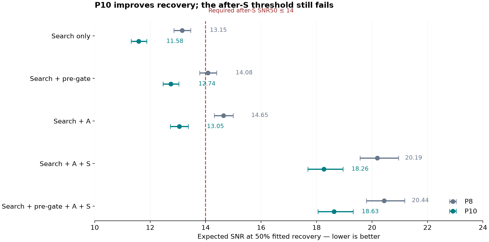

# P10 stopped at the original recovery threshold

Decision recorded 2026-09-12T16:13:36Z. **Stop Rule 1 fails: after-A/S SNR50 is 18.26 [17.69, 18.96], above the required 14.0.** The projected workload passes, at 37.96–69.30 expected C runs under the frozen central model and population bound, below 150. Both requirements must pass. The repairs improve recovery, but the original rule does not justify proceeding to Parts 3–5.

The final action is to preserve and commit this evidence and pause the existing two-hour heartbeat. Parts 3–5 remain unexecuted. Nothing here is a detection or a confirmation.

## Complete calibration

All 2,100 original injections on the same seeded 300 stars completed successfully: 1,240 recovered, 765 missed and 95 aliases. Aliases are not credited. The selected search is e, frozen as `survey_p10`; 600 selected-e searches were reused byte-for-byte and 1,500 ran with identical effective configuration. Fresh A/S records name `p10.0` and `survey_p10`. The full seal covers 15,583 files / 7,915,270,129 bytes. The checked controller closed at 2026-09-12T15:25:46.720252+00:00; no calibration owner or lock remains.

Every level uses 2,100 injections. Brackets are the original algorithm's 16th–84th percentiles from 1,000 individual-injection bootstrap resamples.

| Level | P8 through / 2,100 | P10 through / 2,100 | P8 SNR50 [16–84%] | P10 SNR50 [16–84%] | P8 SNR90 [16–84%] | P10 SNR90 [16–84%] |
|---|---:|---:|---|---|---|---|
| Search only | 1,163 | 1,240 | 13.15 [12.86, 13.46] | 11.58 [11.31, 11.88] | 31.65 [30.08, 33.30] | 29.78 [28.24, 31.57] |
| Search + pre-gate | 1,121 | 1,184 | 14.08 [13.78, 14.40] | 12.74 [12.47, 13.03] | 31.44 [29.89, 33.03] | 30.12 [28.55, 31.85] |
| Search + A | 1,093 | 1,164 | 14.65 [14.31, 15.00] | 13.05 [12.73, 13.38] | 36.66 [34.67, 38.72] | 35.05 [32.98, 37.27] |
| Search + A + S | 904 | 964 | 20.19 [19.56, 20.96] | 18.26 [17.69, 18.96] | 75.18 [69.71, 81.86] | 76.96 [71.10, 84.52] |
| Search + pre-gate + A + S | 896 | 952 | 20.44 [19.80, 21.17] | 18.63 [18.05, 19.32] | 73.98 [68.55, 80.32] | 75.47 [69.78, 82.69] |

**SNR50 naming is explicit.** Frozen HANDOFF section 0.5 says “from 20.19,” identifying search + A + S without the pre-gate: 20.19 → 18.26. Earlier operational prose called the whole pre-gated funnel SNR50_S; that separate curve changes 20.44 → 18.63 [18.05, 19.32]. Both fail 14.0. The frozen section and its original threshold are unchanged. The yield calculation uses the original P8 machinery's pre-gated whole-funnel curve.

## Residual losses

The exact sequential path is **2,100 injected → 1,240 recovered → 1,184 pre-gate → 1,141 A → 952 S**. Search loses 860 (including the 95 aliases); the following steps remove 56, 43 and 189 respectively. These sequential counts differ from the diagnostic A/S levels that omit the pre-gate.

Across every recovered injection, A passes 1,164 and rejects 76, with no errors. Bound S rejects another **200/1,164 = 17.18%** of the A passers, retaining 964. The pre-gate removes 12 of those 964. Relative to P8, search gains 77 recoveries and the pre-gated full funnel gains 56 (896 → 952, or 42.67% → 45.33%). The after-A SNR50 reaches 13.05, while adding S raises it to 18.26. The retained secondary gate is the main remaining downstream sensitivity loss. Its false-kill fraction is nearly the P8 value, 189/1,093 = 17.29%.

The selected secondary mode remains `bound`: it was the only Part 2a mode that passed the frozen negative-control requirement. A failures can overlap: kept events <3 (12), top-event share >50% (19), inconsistent depths (32), kept SNR <7 (31), SNR without the top event <5 (22), and depth outside 0.5–2 times survey depth (9). No threshold was relaxed after observing these losses.

The full-search median/p90/maximum wall times are 444.35/1,284.28/1,681.88 s; 463 jobs hit a detection budget. Median/p90 A times are 100.15/517.11 s and S times 4.40/13.50 s. Search timing includes the preserved 600 selected-e executions and later full-search executions; it is not a fresh paired hardware benchmark.

## False alarms and projected workload

The original 300-star selected-e control search has 3,494 accepted candidates, 709 through the pre-gate, 45 A passers and **2 A+S survivors**. All 709 A and 111 S records validate. The 111 S records include 66 seeded A-failure controls; those are excluded from FA_S. Their 41 S passes are not counted as false-alarm survivors. FA_S = 2/300 = 0.006667 per star, giving **16.873333** for 2,531 stars. Every A/S key and decision matches the earlier selected-e p8.0 comparison.

| Quantity under the recorded model | Expected signals/runs |
|---|---:|
| Original 2,000 stars, central DC15 model through the pre-gated A/S funnel | 21.086755 |
| Original 2,000 stars, search-only diagnostic | 28.277649 |
| Original 2,000 stars, HU19 occurrence sensitivity through the funnel | 27.634104 |
| Up to 531 additional stars, central-model signal upper bound | 31.337769 |
| Prospective population, central-model E_S bounding range | 21.086755–52.424524 |
| FA_S × 2,531 | 16.873333 |
| Projected C load, central-model bounding range | 37.960088–69.297857 |
| Original C-load limit | 150 |

The original P8/DC15 numerical machinery was used with the new recovery curve and a fixed claimed fraction of 0.03 for every detectability class. All 2,000 original per-star prepared-noise files were copied byte-for-byte into an isolated P10 model root, rechecked after execution, and left unchanged. The original geometry, occurrence cells, contamination fill, limb darkening and four-point impact grid remain in use. The legacy low/mid/high fields are identical because their claimed fractions are identical; they are not uncertainty bounds. The engine's explicitly renamed P8 legacy “yield ≥3” diagnostic does not determine P10 continuation.

The additional stars lack measured noise in this calibration. The upper endpoint therefore adds the 531 largest nonnegative geometric signal weights from the entire 1,837-star bare-SPOC-only source pool, assuming perfect recovery. This bounds any eventual subset of at most 531 without selecting that subset or opening its TCE ephemerides or candidate outcomes. It is a sufficient bound for the central-model load criterion, **not a point estimate, confidence interval or bound on the realized candidate count**. The previously recorded all-population perfect-recovery bound, 148.931096 C runs, also lies below 150.

## Repairs, compatibility and limits

Part 2a retains bound S; Part 2b selects e / `survey_p10_both` and freezes its effective fields as `survey_p10`. Part 2c retains strongest-peak rule (a), with conditional robust fallback and the one-cadence duration floor. All comparative (b) conditions passed, but three of seven half/double controls pass both rules, so the original absolute alias-failure requirement prevents adopting (b). This pre-existing limitation remains disclosed. Selected injection-C retention is 24/30: 8/10 at SNR [7,12), 6/10 at [12,20), 10/10 at [20,50). Each corrected EB comparison has 16 PASS and 25 FAIL, with no new FAIL-to-PASS flip; only HIP 97166 b changes under fallback among the native development cases.

The EB controls retain their original catalogue-windowed development exposure; they are not a blind holdout. The two TIC 92743594 controls lie outside the inherited blind grid and do not establish successful alias rejection. The excluded sector-filtered EB attempts, exact-unit correction and thirteenth injection's suspension-inflated raw timers remain preserved.

P7 reproduces 823 records across all 16 slices with 0 field differences, 0 decision differences and worst relative difference 0.0; 2,513 P6 input hashes are unchanged. The seeded P8 cached replay is 20/20 byte-identical. A separate fresh replay is scientifically identical but 0/20 byte-identical because timestamps and measured runtimes differ. The latest full regression passed 774 tests, with 1 skipped and 9 warnings; ten subsequent schema-guard/routing checks and three load-bound checks passed. Thirteen final yield, bound and legacy-yield checks passed (one known optional lightkurve dependency warning). No full unchanged-source baseline was repeated at periodic checks.

The original calibration controller's validation guard compared the Stage A writer schema against rule-summary metadata. The checked successor corrected only that guard after exact owner closure, validated and reused every completed A record, then finished S and injection analysis. The numerical thresholds and original worker outputs did not change. Its original failed-guard diagnostics remain part of the provenance.

Bootstrap intervals resample individual injections and do not model within-star dependence, population uncertainty or model misspecification. The logistic crossing is an SNR-marginal fit. The fixed FA extrapolation has sampling uncertainty. HU19 is an inherited occurrence-box rescaling sensitivity, including its radius-distribution and spectral-type assumptions, and does not replace the frozen central DC15 criterion. Later B/C/D losses and final candidate counts remain unknown. P8/P9 records, frozen section 0, candidate identities and exposure boundaries are preserved.

## Evidence

Repository: `C:\Users\seanj\Downloads\tess-exoplanet-candidate-hunter\tess-exoplanet-candidate-hunter`, branch `improve/recovery`.

- `p10/results/part2d_calibration_20260912/stop_rule_1_decision.json`: exact decision, level tables, input hashes and loss counts.
- `full_calibration_closed_seal_20260912.json` in the same directory: every scientific artifact and verified controller closure.
- `expected_yield_projection_p10.json` and `yield_model/`: measured yield, noise provenance, execution log and closed model seal.
- `COMPLETENESS_P10.md`: all SNR/period/radius/magnitude/rotation bins and failure diagnostics.
- `docs/RULES.md` section 9: accumulated rule choices and full calibration.
- `HANDOFF_P10.md` / `RESUME_P10.md`: final stop and operational entry point; older execution entries are historical.

Frozen section 0 SHA-256: `01bd29efc1b4b57eb6fcc99f340f515c0c2cae2e0162a2e9f96beef92b678f19`.

Operational confirmation: the existing adaptive heartbeat was verified **PAUSED** at 2026-09-12T16:15:47.109854+00:00, retaining its 120-minute default. See `finalization_20260912/automation_paused_verified.json`.
