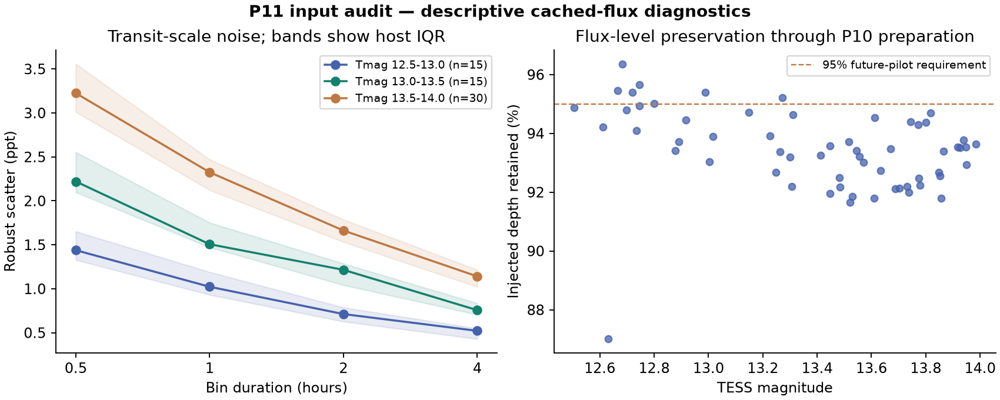

# P11 input audit — evaluation stopped on common coverage

Recorded 2026-09-12T20:48:47.915532+00:00. The initial audit is complete. The main search/S/C experiment was not launched because its prescribed 300-host/600-injection development comparison cannot be supplied with qualifying common inputs. This is a data-limited incomplete evaluation, not a negative recovery result.

## Provenance and coverage

All **300 development hosts** were inventoried, including **8,349 raw product arrays** and their original FITS sources. TIME, selected flux, SAP and quality match exactly after reproducing Lightkurve's removal of nonfinite-TIME rows. The initial audit-reader mismatch and its correction are preserved in `results/input_inventory/`, `input_inventory_v2/` and the source snapshots; the historical arrays were never repaired in place.

All **437 cached QLP products from sectors 74–79** match corrected v02 source timestamps. The current official MAST notice still marks sectors 99–104 as awaiting corrected redelivery. Six metadata-selected fresh downloads, one per sector, have TIME and DET_FLUX identical to the cache. This checks those fixtures; it does not prove every file's redelivery state. A v01 filename by itself was never used to diagnose bad timestamps. [MAST release notices](https://archive.stsci.edu/hlsp/qlp)

The independent same-CADENCENO comparison contains **1,563 QLP/TESS-SPOC pairs**. After both P10 quality masks, sector 80 has 51/51 pairs with discrepancies exceeding 100 seconds; median offsets range **166.24–205.78 seconds**. Sector 83 has 47/47 pairs with some offsets above 10 seconds, though their medians remain near two seconds. Sector 85 has 42/54 pairs with offsets above 100 seconds. These are unresolved timing discrepancies, not transit-derived correction recipes. Both time standards and reference headers, raw extrema and quality selections are archived. No catalogue transit period, flux correlation or fitted time shift was used.

The frozen common policy excludes QLP sectors **80, 83, 85 and 99–104**, retains verified corrected 74–79 products, and preserves the original author preference and cadence/preparation rules. **241/300 cached hosts** have at least three remaining sectors; 59 do not. That count is optimistic because the original native-FFI and strict-minority two-minute requirements are additional conditions.

Current metadata was queried for all **2,000 original targets**, yielding 80,837 observation records. Even before the extra 80/83/85 exclusions, **58/300 development hosts** have fewer than three unaffected sectors under an optimistic *any-author* availability bound; **104/600 fixed comparison injections** are on those hosts. The native-FFI population bound fails for 64 hosts / 114 comparison injections. These are input-availability failures, not missed injected planets.

Six targets have sector 69 in current metadata but absent from the cached usable index; one is a development host. All six records carry a **June 2, 2025** public release date, so they are cache omissions rather than demonstrated September coverage growth. Metadata identifies 0 targets with a qualifying observation release date on or after September 5, 2026 within sectors 56–104. **Zero newly delivered usable sectors were established per target.** The full per-target tables distinguish availability, dated releases and verified usability. Original release dates cannot date an overwritten product. New metadata outside the frozen sector ceiling is disclosed in the raw inventory and not silently added.

No new real-candidate outcomes, reserved 531-star ephemerides or fresh validation hosts were opened. No conclusion is drawn about the size of a potential fresh validation pool.

## Transit-scale noise and preservation

All **60 registered audit hosts** completed: 30 at Tmag 13.5–14.0, 15 at 13.0–13.5 and 15 at 12.5–13.0. The tables record QLP before/from sector 94, source crowding, raw variability, quality, duty cycle and failures. QLP's sector-94 transition uses TGLC photometry. [MIT QLP notes](https://tess.mit.edu/qlp/)

These are descriptive cached-flux measurements. The subsequently identified 80/83/85 timing caveats remain attached to those measurements; they are not claimed as a successful common-input experiment. Each star received one registered exposure-integrated batman preservation signal, multiplied into SAP and corrected streams before detrending. These 60 engineering signals are not the proposed 1,050 validation injections.

Numbers below are medians over hosts, with 95% intervals from 10,000 bootstrap resamples within the fixed magnitude strata. They describe the deliberate 30/15/15 audit allocation, not a population-weighted survey estimate.

| Measurement | Median [95% host interval] |
|---|---:|
| Point scatter, ppt | 7.860 [7.255, 8.865] |
| 0.5-hour scatter, ppt | 2.658 [2.390, 2.990] |
| 1-hour scatter, ppt | 1.868 [1.689, 2.095] |
| 2-hour scatter, ppt | 1.333 [1.233, 1.472] |
| 4-hour scatter, ppt | 0.913 [0.836, 1.018] |
| 1-hour red-noise inflation | 1.017 [1.007, 1.027] |
| Default injected depth retained, % | 93.499 [93.207, 93.710] |

The supplied QLP small aperture is available on **53/60 hosts**. On matched star/sector/time samples its median one-hour noise ratio to default is **0.639 [0.627, 0.648]**, about **36.1% lower noise**. Its median injected-depth retention is **93.902 [93.505, 94.027]%**, below 95%. The large-aperture noise ratio is 1.324 [1.299, 1.344]; SAP/default is 0.988 [0.974, 1.001]. Every per-sector artifact tail and retention failure remains in the raw tables. A median zero tail difference or degenerate bootstrap is not evidence of zero artifact risk or proof of a no-worse tail.

Flux-level multiplication imposes the same fractional signal in each aperture. It cannot test real target throughput losses, changing dilution, background subtraction in pixels or centroid localization. **No TESScut/pixel pilot was run and no production extractor or aperture change is recommended for adoption.** The supplied small aperture is a useful later test target; it does not establish the joint >=15% noise / >=95% depth / no-worse-artifact requirement.

The physical noise supplement measures **311/684 star-sector count-noise models** using source electrons, summed sky, aperture area, live integration/read counts and the actual READNOIA–D calibration. The amplifier range is reported instead of guessing a CCD output; crowding scaling and cosmic-ray/cotrending limitations are explicit. QLP products lacking joint physical calibration remain unmeasurable. This supplement supersedes the initial compact-header placeholder, which omitted the amplifier/live-time keywords. A photon-only floor is reported beside the total model, never substituted for it. [Mission data products](https://heasarc.gsfc.nasa.gov/docs/tess/data-products.html), [cosmic-ray processing](https://heasarc.gsfc.nasa.gov/docs/tess/TESS-CosmicRayPrimer.html)

## Cost and integrity

Downloads total **81.828 MB**, against 15 GB. Free disk is **68.33 GB**, above the 30 GB headroom. The successful noise controller used four single-thread workers after a measured **354.9 MB** memory pilot. Median / p90 / maximum host wall times were **16.63 / 37.34 / 43.60 seconds**. These are photometry-audit timings, not C_local benchmarks.

Durable scientific-job intervals total about **11.92 minutes**. For budget certification, charge **0.921 queue-hours conservatively**, covering the entire inspection-to-close span plus an initial allowance, including uninstrumented short diagnostics and engineering time. This remains below both the 2-hour audit cap and 48-hour experiment cap. The failed import attempt's 64.89 seconds and all original failed records are preserved. Complete process-tree CPU for those failed imports is unavailable; no C speed or whole-funnel CPU claim is made.

Final regression: **793 passed, 1 skipped**. The P9 verifier has **396 passing content checks and only the expected HEAD-equality failure**, and its old receipt was restored byte for byte in a finally block. All **554 registered source/evidence/index hashes**, **15,583 sealed P10 calibration files**, and **16,698 raw/FITS files** verify unchanged. The old named configurations and P10's failed 18.26124-versus-14 stop remain intact.

## Costed next step, outside this execution

Restore authoritative comparable input coverage before registering another efficacy comparison. The six new release checks show the still-pending products cannot currently supply that repair. The currently missing sector-69 alternatives are historical availability, not a new release. Do not relabel a reduced development sample as the required original 300/600 population.

For scale, the full historical 900-job P10 e timing distribution sums to **176.53 job-hours**. A FIFO simulation using each recorded job time and its tail takes **11.21 hours at 16 workers**, or **7.56 hours at 24**, before new A/S/C work. This is a historical scheduling scenario, not a new-input performance forecast. R1 confirmation cost and C_local throughput remain unmeasured, so a validation affordability projection cannot yet be justified. No follow-on experiment or automation was started.
