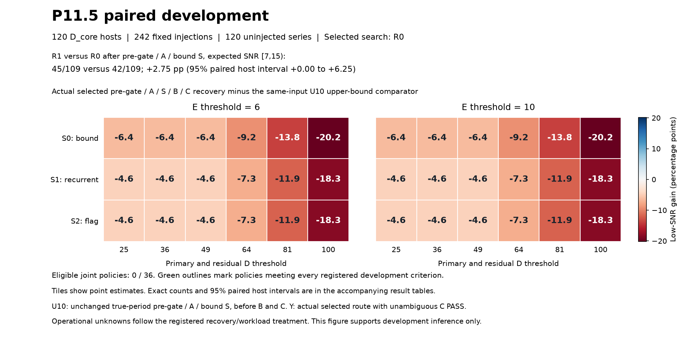

# P11.5 C_local: measured joint development

Completed development: 120 D_core hosts, 242 fixed injections, and 120 uninjected series.

No joint policy satisfied every registered development admission requirement; no fresh holdout was used to search for a winner.

Final decisions use only C_local v2. Static review before aggregate recovery scoring corrected the broad BLS minimum duration from an unintended 0.02 days to one native cadence, and required residual support to retain the candidate period/epoch. The registered finite thresholds, model family and 600-second deadline stayed fixed. Every first-version result and attempt cost is retained; corrected measurements use separate source, input, result and model identities. See `manifests/C_v2_correctness_registration.json` and `manifests/c_v2_execution_freeze.json`.

C_local fits an exposure-integrated trapezoid family to native prepared flux/error arrays. The physical chi-squared uses measured sector noise inflation and identical per-sector constant and linear baselines for flat, planet and two-eclipse fits. This is a finite template discriminator, not an astrophysical radius fit or FPP. Fitted models, flat/transit chi-squared, baseline coefficients, noise inflation and finite-grid diagnostics are archived.

The frozen local ratios are 1/3, 1/2, 2/3, 1, 3/2, 2 and 3, each within 1.5%. Local BLS uses 257 periods and eight durations, geometric and BLS phase seeds, three ingress fractions and bounded refinement. Seven exposure subsamples and a one-cadence duration floor are retained. Physical impossibility and software/grid limits are distinct. Broader native BLS uses 40,000 periods over 0.5–110 days, at most four unrelated competitors and at most three P10 residual masks with three covered events.

Two-eclipse fits at P and 2P optimize secondary phase, depth, duration and ingress with 32 phase seeds. Parameter counts are 2S for flat, 2S+5 for planet and 2S+9 for two-eclipse, where S is the number of sectors. E compares the candidate planet BIC with the fitted binary BIC; rejection additionally requires registered recurrence in at least two sectors. A distinct single-transit alias better by more than six BIC points rejects the primary; two alternatives clearing D and within six BIC points remain unresolved.

Unchanged B is measured before C. The actual ordered route and isolated S/C are both reported. Operational errors and timeouts are never clean passes or measured rejections. Natural unresolved candidates are forwarded; corresponding injections are not recovered. Historical protection requires measured rejection in both isolated S/C and the ordered route. Catalogue-conditioned historical controls are labelled engineering evidence outside survey-domain inference.

| Policy | Low-SNR gain pp | Y / n | Protected / 26 | Natural forwarded candidates | C median / p90 s | C unknown / arrivals | CPU / R0 | Eligible |
|---|---:|---:|---:|---:|---:|---:|---:|---|
| R0_S0_D25_E6 | -6.42 | 35 / 109 | 21 | 1 | 60.12 / 285.98 | 13 / 119 | 1.03 | False |
| R0_S0_D25_E10 | -6.42 | 35 / 109 | 21 | 1 | 60.12 / 285.98 | 13 / 119 | 1.03 | False |
| R0_S0_D36_E6 | -6.42 | 35 / 109 | 21 | 1 | 60.12 / 285.98 | 11 / 119 | 1.03 | False |
| R0_S0_D36_E10 | -6.42 | 35 / 109 | 21 | 1 | 60.12 / 285.98 | 11 / 119 | 1.03 | False |
| R0_S0_D49_E6 | -6.42 | 35 / 109 | 21 | 0 | 60.12 / 285.98 | 10 / 119 | 1.03 | False |
| R0_S0_D49_E10 | -6.42 | 35 / 109 | 21 | 0 | 60.12 / 285.98 | 10 / 119 | 1.03 | False |
| R0_S0_D64_E6 | -9.17 | 32 / 109 | 21 | 0 | 60.12 / 285.98 | 9 / 119 | 1.03 | False |
| R0_S0_D64_E10 | -9.17 | 32 / 109 | 21 | 0 | 60.12 / 285.98 | 9 / 119 | 1.03 | False |
| R0_S0_D81_E6 | -13.76 | 27 / 109 | 21 | 0 | 60.12 / 285.98 | 6 / 119 | 1.03 | False |
| R0_S0_D81_E10 | -13.76 | 27 / 109 | 21 | 0 | 60.12 / 285.98 | 6 / 119 | 1.03 | False |
| R0_S0_D100_E6 | -20.18 | 20 / 109 | 21 | 0 | 60.12 / 285.98 | 6 / 119 | 1.03 | False |
| R0_S0_D100_E10 | -20.18 | 20 / 109 | 21 | 0 | 60.12 / 285.98 | 6 / 119 | 1.03 | False |
| R0_S1_D25_E6 | -4.59 | 37 / 109 | 17 | 4 | 71.25 / 274.23 | 22 / 167 | 1.04 | False |
| R0_S1_D25_E10 | -4.59 | 37 / 109 | 17 | 4 | 71.25 / 274.23 | 22 / 167 | 1.04 | False |
| R0_S1_D36_E6 | -4.59 | 37 / 109 | 17 | 4 | 71.25 / 274.23 | 20 / 167 | 1.04 | False |
| R0_S1_D36_E10 | -4.59 | 37 / 109 | 17 | 4 | 71.25 / 274.23 | 20 / 167 | 1.04 | False |
| R0_S1_D49_E6 | -4.59 | 37 / 109 | 17 | 3 | 71.25 / 274.23 | 19 / 167 | 1.04 | False |
| R0_S1_D49_E10 | -4.59 | 37 / 109 | 17 | 3 | 71.25 / 274.23 | 19 / 167 | 1.04 | False |
| R0_S1_D64_E6 | -7.34 | 34 / 109 | 17 | 3 | 71.25 / 274.23 | 17 / 167 | 1.04 | False |
| R0_S1_D64_E10 | -7.34 | 34 / 109 | 17 | 3 | 71.25 / 274.23 | 17 / 167 | 1.04 | False |
| R0_S1_D81_E6 | -11.93 | 29 / 109 | 17 | 2 | 71.25 / 274.23 | 13 / 167 | 1.04 | False |
| R0_S1_D81_E10 | -11.93 | 29 / 109 | 17 | 2 | 71.25 / 274.23 | 13 / 167 | 1.04 | False |
| R0_S1_D100_E6 | -18.35 | 22 / 109 | 17 | 0 | 71.25 / 274.23 | 12 / 167 | 1.04 | False |
| R0_S1_D100_E10 | -18.35 | 22 / 109 | 17 | 0 | 71.25 / 274.23 | 12 / 167 | 1.04 | False |
| R0_S2_D25_E6 | -4.59 | 37 / 109 | 16 | 4 | 80.36 / 304.74 | 22 / 285 | 1.08 | False |
| R0_S2_D25_E10 | -4.59 | 37 / 109 | 16 | 4 | 80.36 / 304.74 | 22 / 285 | 1.08 | False |
| R0_S2_D36_E6 | -4.59 | 37 / 109 | 16 | 4 | 80.36 / 304.74 | 20 / 285 | 1.08 | False |
| R0_S2_D36_E10 | -4.59 | 37 / 109 | 16 | 4 | 80.36 / 304.74 | 20 / 285 | 1.08 | False |
| R0_S2_D49_E6 | -4.59 | 37 / 109 | 16 | 3 | 80.36 / 304.74 | 19 / 285 | 1.08 | False |
| R0_S2_D49_E10 | -4.59 | 37 / 109 | 16 | 3 | 80.36 / 304.74 | 19 / 285 | 1.08 | False |
| R0_S2_D64_E6 | -7.34 | 34 / 109 | 16 | 3 | 80.36 / 304.74 | 17 / 285 | 1.08 | False |
| R0_S2_D64_E10 | -7.34 | 34 / 109 | 16 | 3 | 80.36 / 304.74 | 17 / 285 | 1.08 | False |
| R0_S2_D81_E6 | -11.93 | 29 / 109 | 16 | 2 | 80.36 / 304.74 | 13 / 285 | 1.08 | False |
| R0_S2_D81_E10 | -11.93 | 29 / 109 | 16 | 2 | 80.36 / 304.74 | 13 / 285 | 1.08 | False |
| R0_S2_D100_E6 | -18.35 | 22 / 109 | 16 | 0 | 80.36 / 304.74 | 12 / 285 | 1.08 | False |
| R0_S2_D100_E10 | -18.35 | 22 / 109 | 16 | 0 | 80.36 / 304.74 | 12 / 285 | 1.08 | False |

Historical negative records forwarded by the actual ordered route are shown below. Each count includes PASS and UNRESOLVED. These are candidate-conditioned engineering records, with overlap retained across collections; the union column counts distinct exact measurement identities.

| Policy | S EB forwarded / 18 | S blend forwarded / 22 | C EB forwarded / 41 | Distinct negative identities forwarded |
|---|---:|---:|---:|---:|
| R0_S0_D25_E6 | 5 | 7 | 10 | 22 |
| R0_S0_D25_E10 | 5 | 7 | 10 | 22 |
| R0_S0_D36_E6 | 5 | 7 | 10 | 22 |
| R0_S0_D36_E10 | 5 | 7 | 10 | 22 |
| R0_S0_D49_E6 | 5 | 7 | 10 | 22 |
| R0_S0_D49_E10 | 5 | 7 | 10 | 22 |
| R0_S0_D64_E6 | 5 | 7 | 10 | 22 |
| R0_S0_D64_E10 | 5 | 7 | 10 | 22 |
| R0_S0_D81_E6 | 5 | 7 | 10 | 22 |
| R0_S0_D81_E10 | 5 | 7 | 10 | 22 |
| R0_S0_D100_E6 | 5 | 7 | 10 | 22 |
| R0_S0_D100_E10 | 5 | 7 | 10 | 22 |
| R0_S1_D25_E6 | 5 | 9 | 10 | 24 |
| R0_S1_D25_E10 | 5 | 9 | 10 | 24 |
| R0_S1_D36_E6 | 5 | 9 | 10 | 24 |
| R0_S1_D36_E10 | 5 | 9 | 10 | 24 |
| R0_S1_D49_E6 | 5 | 9 | 10 | 24 |
| R0_S1_D49_E10 | 5 | 9 | 10 | 24 |
| R0_S1_D64_E6 | 5 | 9 | 10 | 24 |
| R0_S1_D64_E10 | 5 | 9 | 10 | 24 |
| R0_S1_D81_E6 | 5 | 9 | 10 | 24 |
| R0_S1_D81_E10 | 5 | 9 | 10 | 24 |
| R0_S1_D100_E6 | 5 | 9 | 10 | 24 |
| R0_S1_D100_E10 | 5 | 9 | 10 | 24 |
| R0_S2_D25_E6 | 6 | 9 | 13 | 28 |
| R0_S2_D25_E10 | 6 | 9 | 13 | 28 |
| R0_S2_D36_E6 | 6 | 9 | 13 | 28 |
| R0_S2_D36_E10 | 6 | 9 | 13 | 28 |
| R0_S2_D49_E6 | 6 | 9 | 13 | 28 |
| R0_S2_D49_E10 | 6 | 9 | 13 | 28 |
| R0_S2_D64_E6 | 6 | 9 | 13 | 28 |
| R0_S2_D64_E10 | 6 | 9 | 13 | 28 |
| R0_S2_D81_E6 | 6 | 9 | 13 | 28 |
| R0_S2_D81_E10 | 6 | 9 | 13 | 28 |
| R0_S2_D100_E6 | 6 | 9 | 13 | 28 |
| R0_S2_D100_E10 | 6 | 9 | 13 | 28 |

Historical registration contains 208 rows and 205 unique exact measurement identities; 0 input handoffs were unavailable. The five collections retain 40 original S controls (18 EB, 22 blend), the distinct 41-record EB C collection, 37 native C records, 30 injection-C controls and 60 fixed-hash S-killed injections. The seven known half/double records remain tagged. Exact joins and overlap are in `manifests/control_joins.json`.

The three persistent P10 C(a) passes are reported individually below. Entries give ordered / isolated status for every registered policy.

| Policy | eb_tic178858648_candidate1 | eb_tic237116051_candidate1 | eb_tic272598447_candidate1 |
|---|---|---|---|
| R0_S0_D25_E6 | REJECT / PASS | REJECT / PASS | REJECT / REJECT |
| R0_S0_D25_E10 | REJECT / PASS | REJECT / PASS | REJECT / REJECT |
| R0_S0_D36_E6 | REJECT / PASS | REJECT / PASS | REJECT / REJECT |
| R0_S0_D36_E10 | REJECT / PASS | REJECT / PASS | REJECT / REJECT |
| R0_S0_D49_E6 | REJECT / PASS | REJECT / PASS | REJECT / REJECT |
| R0_S0_D49_E10 | REJECT / PASS | REJECT / PASS | REJECT / REJECT |
| R0_S0_D64_E6 | REJECT / PASS | REJECT / PASS | REJECT / REJECT |
| R0_S0_D64_E10 | REJECT / PASS | REJECT / PASS | REJECT / REJECT |
| R0_S0_D81_E6 | REJECT / PASS | REJECT / PASS | REJECT / REJECT |
| R0_S0_D81_E10 | REJECT / PASS | REJECT / PASS | REJECT / REJECT |
| R0_S0_D100_E6 | REJECT / PASS | REJECT / PASS | REJECT / REJECT |
| R0_S0_D100_E10 | REJECT / PASS | REJECT / PASS | REJECT / REJECT |
| R0_S1_D25_E6 | REJECT / PASS | REJECT / PASS | REJECT / REJECT |
| R0_S1_D25_E10 | REJECT / PASS | REJECT / PASS | REJECT / REJECT |
| R0_S1_D36_E6 | REJECT / PASS | REJECT / PASS | REJECT / REJECT |
| R0_S1_D36_E10 | REJECT / PASS | REJECT / PASS | REJECT / REJECT |
| R0_S1_D49_E6 | REJECT / PASS | REJECT / PASS | REJECT / REJECT |
| R0_S1_D49_E10 | REJECT / PASS | REJECT / PASS | REJECT / REJECT |
| R0_S1_D64_E6 | REJECT / PASS | REJECT / PASS | REJECT / REJECT |
| R0_S1_D64_E10 | REJECT / PASS | REJECT / PASS | REJECT / REJECT |
| R0_S1_D81_E6 | REJECT / PASS | REJECT / PASS | REJECT / REJECT |
| R0_S1_D81_E10 | REJECT / PASS | REJECT / PASS | REJECT / REJECT |
| R0_S1_D100_E6 | REJECT / PASS | REJECT / PASS | REJECT / REJECT |
| R0_S1_D100_E10 | REJECT / PASS | REJECT / PASS | REJECT / REJECT |
| R0_S2_D25_E6 | REJECT / PASS | REJECT / PASS | REJECT / REJECT |
| R0_S2_D25_E10 | REJECT / PASS | REJECT / PASS | REJECT / REJECT |
| R0_S2_D36_E6 | REJECT / PASS | REJECT / PASS | REJECT / REJECT |
| R0_S2_D36_E10 | REJECT / PASS | REJECT / PASS | REJECT / REJECT |
| R0_S2_D49_E6 | REJECT / PASS | REJECT / PASS | REJECT / REJECT |
| R0_S2_D49_E10 | REJECT / PASS | REJECT / PASS | REJECT / REJECT |
| R0_S2_D64_E6 | REJECT / PASS | REJECT / PASS | REJECT / REJECT |
| R0_S2_D64_E10 | REJECT / PASS | REJECT / PASS | REJECT / REJECT |
| R0_S2_D81_E6 | REJECT / PASS | REJECT / PASS | REJECT / REJECT |
| R0_S2_D81_E10 | REJECT / PASS | REJECT / PASS | REJECT / REJECT |
| R0_S2_D100_E6 | REJECT / PASS | REJECT / PASS | REJECT / REJECT |
| R0_S2_D100_E10 | REJECT / PASS | REJECT / PASS | REJECT / REJECT |

All original control rows and all 36 policy outcomes are preserved, including missing/unknown reasons in per-stage records. No perfect rejection criterion was added after seeing outcomes, and no survivor is excused by a possible later D rejection.

There are 43 operationally failed required stage records across the paired R0/R1 and historical-engineering domains. Their exact identities, stages and errors are in `results/development_evaluation.json`; full controller and measurement statuses and all costs are in `results/resource_accounting_final.json`. Scientific UNRESOLVED decisions are reported separately from INPUT_ERROR and TIMEOUT.

2 completed payload artifacts had owning-controller TIMEOUT receipts. The registered controller deadline takes precedence: exact original payload bytes and timings remain in `results/late_payloads_v1/`, while subsequent handoffs and recovery/workload accounting use terminal operational unknowns. The uniform rule, discovered before aggregate efficacy scoring, is registered in `manifests/operational_deadline_precedence_v1.json`; per-application receipts are `results/deadline_precedence_*.json`. Already computed descendants and all attempt costs remain preserved.

The original-NPZ storage forecast exceeded available headroom, so all 897 remaining corrected-C candidates were retained in 13 finite batches. Completed model containers were packed losslessly as XZ; original NPZ hashes and exact-container verification receipts remain in `results/model_storage/C_v2/`. Packing owners occupied 0.1057 queue-hours, included in total expenditure. These storage phases are separate from the scientific C measurements. The frozen plan and each disk/memory/budget preflight are in `manifests/c_v2_storage_plan_v1.json` and `results/c_v2_batch_checks/`. Every C case retained its 600-second deadline, and each packing job had a separate 300-second deadline.

Natural candidate PASS and UNRESOLVED counts, host intervals and the complete multiplicity histogram for every policy are in `results/development_evaluation.json`. The same fields for the R0 pre-C post-S comparator remain separate. Forwarded natural candidates are not labelled confirmed contaminants.

Optional broad-TLS reference runs were allocated zero. No paired threefold CPU speed-up claim is made. Native C and end-to-end measured cost, including failed-attempt expenditure, are reported independently.

SNR50/SNR90 in `results/sensitivity_tables.json` are fitted point diagnostics with extrapolated or unidentified crossings labelled. P10's historical after-A/S SNR50 of 18.26124 and pre-gated 952/2,100 recovery remain unchanged.

The unretuned P10 endpoint risks remain: confirmed TOI-762 A b and TOI-122 b are rejected by tier thresholds; TIC 144277542 changes from artifact KILL to SUBMIT under rescoring. P11.5 does not repair or validate these endpoints.

All 898 required corrected-C attempts and their 898 packed model archives completed with verified candidate, input, source and container identities. Operationally COMPLETE C measurements can still yield scientific UNRESOLVED decisions. The final audit is `results/c_v2_final_operational_integrity_v1.json`; all 28 scientific-C and packing owners are closed. The actual development figure passed visual QA (`results/development_overview_visual_qa_v1.json`).

The prediction freeze followed a full regression of 886 passed / 1 skipped tests (9 warnings). A later sensitivity-table export exposed a NumPy boolean serialization issue. The versioned `protocol/sensitivity_tables_v2.py` adapter converts NumPy scalars only at the JSON writer boundary; the original diagnostic calculations, every prediction-freeze source hash, and the single development evaluation remain unchanged. The complete follow-up regression passed 891 tests with 1 skipped and 9 warnings; its source-hash checks passed. See `manifests/sensitivity_serialization_v2.json` and `results/regression_after_reporting_serialization_v4/`.
